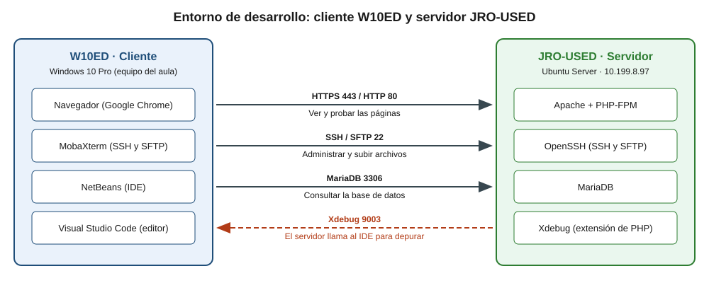

# JRODAWProyectoDAW

**Despliegue de Aplicaciones Web** · 2.º DAW · IES Los Sauces · Curso 2026/2027

Repositorio de la asignatura **Despliegue de Aplicaciones Web**: reúne la aplicación del proyecto y toda la documentación del entorno en el que se despliega, desde la instalación del servidor hasta la configuración del equipo de desarrollo.

---

## Índice

- [La asignatura](#la-asignatura)
- [El entorno de trabajo](#el-entorno-de-trabajo)
- [Documentación](#documentación)
- [Estructura del repositorio](#estructura-del-repositorio)
- [Cómo usar este repositorio](#cómo-usar-este-repositorio)
- [Equipo](#equipo)

---

## La asignatura

**Despliegue de Aplicaciones Web** (módulo profesional 0614) forma parte del segundo curso del ciclo formativo de grado superior en **Desarrollo de Aplicaciones Web (DAW)**.

Programar una aplicación es solo la mitad del trabajo: para que alguien pueda usarla hay que **desplegarla**, es decir, ponerla en funcionamiento en un servidor al que se pueda acceder desde un navegador, de forma segura y mantenible. De eso trata la asignatura: de todo lo que ocurre entre "en mi equipo funciona" y "está publicada".

**Qué se aprende:**

| Bloque | En qué consiste |
|---|---|
| Arquitecturas web | Cómo se reparte el trabajo entre el cliente (navegador) y el servidor, y qué piezas intervienen en una petición |
| Servidores web | Instalar, configurar y asegurar un servidor web (Apache): sitios virtuales, HTTPS, módulos y registros |
| Servidores de aplicaciones | Ejecutar el código de la aplicación en el servidor (PHP-FPM) y conectarlo con la base de datos (MariaDB) |
| Transferencia de archivos | Publicar el código en el servidor de forma segura (SFTP) y con usuarios de permisos limitados |
| Servicios de red | Resolución de nombres (DNS) y servicios de directorio para la autenticación de usuarios |
| Documentación y control de versiones | Documentar las aplicaciones y los entornos, y gestionar el código con Git y GitHub |

> La idea que recorre todo el curso es que un despliegue debe poder **repetirse**: por eso cada instalación de este repositorio está documentada paso a paso, de modo que cualquiera pueda reconstruir el entorno desde cero.

<!-- RELLENAR (opcional): unidades didácticas del curso -->

| Unidad | Título | Material |
|---|---|---|
| UD 1 | <!-- título --> | [Enlace](#) |
| UD 2 | <!-- título --> | [Enlace](#) |
| UD 3 | <!-- título --> | [Enlace](#) |

---

## El entorno de trabajo

Se trabaja con dos máquinas: un **servidor** donde se ejecutan las aplicaciones y un **cliente** desde el que se programa.



| | Servidor de desarrollo | Cliente de desarrollo |
|---|---|---|
| **Nombre** | `JRO-USED` | `W10ED` |
| **Sistema** | Ubuntu Server 26.04 LTS | Windows 10 Pro |
| **Función** | Ejecuta y sirve las aplicaciones | Edita el código y lo envía al servidor |
| **Software** | Apache · PHP-FPM · MariaDB · phpMyAdmin · Xdebug · OpenSSH | Navegador · MobaXterm · NetBeans · Visual Studio Code |
| **Guía** | [Instalación del servidor](docs/Guia_Instalacion_JRO_USED.md) | [Configuración del cliente](docs/Guia_proyectos_JRO_VSC.md) |

---

## Documentación

Toda la documentación está en la carpeta [`docs/`](docs/) y sigue el mismo esquema: **Máquina** (configuración inicial), **Servicio** (instalación, configuración, monitorización y mantenimiento) y **Software** (instalación, configuración y ejemplo de uso).

### Entorno de desarrollo

| Documento | Contenido |
|---|---|
| [Guía de instalación del servidor (USED)](docs/Guia_Instalacion_JRO_USED.md) | Máquina virtual, red, cuentas, Apache con HTTPS, PHP-FPM, MariaDB, phpMyAdmin, Xdebug y usuarios SFTP enjaulados |
| [Guía de configuración del cliente (W10ED)](docs/Guia_proyectos_JRO_VSC.md) | MobaXterm, NetBeans y Visual Studio Code con sus extensiones: subida por SFTP, base de datos, Git y depuración |

### Otros documentos

<!-- RELLENAR: sustituye el título, la ruta (#) y la descripción de cada fila. Añade o borra filas según haga falta. -->

| Documento | Contenido |
|---|---|
| [Título del documento](#) | <!-- descripción --> |
| [Título del documento](#) | <!-- descripción --> |
| [Título del documento](#) | <!-- descripción --> |
| [Título del documento](#) | <!-- descripción --> |

### Enlaces de interés

<!-- RELLENAR: enlaces externos (aplicación desplegada, otros repositorios, portfolio...). -->

| Recurso | Enlace |
|---|---|
| Aplicación desplegada (servidor de desarrollo) | <!-- URL --> |
| Aplicación desplegada (explotación) | <!-- URL --> |
| Otros repositorios del curso | <!-- URL --> |

---

## Estructura del repositorio

```text
JRODAWProyectoDAW/
├── README.md                  -> este índice
├── indexProyectoDAW.php       -> página principal del proyecto
├── docs/                      -> documentación del entorno
│   ├── Guia_Instalacion_JRO_USED.md
│   ├── Guia_proyectos_JRO_VSC.md
│   └── images/                -> capturas y esquemas de las guías
└── webroot/                   -> recursos de la aplicación
    ├── css/                   -> hojas de estilo
    ├── script/                -> JavaScript
    ├── images/                -> imágenes de la aplicación
    ├── font/                  -> tipografías
    └── docs/                  -> documentos descargables desde la web
```

> **Convención de nombres.** Los proyectos del curso se nombran con las iniciales del autor, el módulo y el nombre del proyecto: `JRO` + `DAW` + `ProyectoDAW`.

---

## Cómo usar este repositorio

**Para consultar la documentación**, basta con abrir los enlaces del apartado [Documentación](#documentación): GitHub muestra las guías con su formato y sus imágenes.

**Para desplegar el proyecto en el servidor de desarrollo:**

1. Clona el repositorio en el equipo cliente:

   ```bash
   git clone https://github.com/juanrivord/JRODAWProyectoDAW.git
   ```

2. Crea la carpeta del proyecto en el servidor, con el usuario `operadorweb`:

   ```bash
   mkdir /var/www/html/JRODAWProyectoDAW
   ```

3. Configura la subida por SFTP en tu editor (NetBeans o Visual Studio Code), como explica la [guía del cliente](docs/Guia_proyectos_JRO_VSC.md), y sube los archivos.
4. Abre el proyecto en el navegador: `https://<IP-del-servidor>/JRODAWProyectoDAW/indexProyectoDAW.php`

---

## Equipo

**Autor del repositorio:** Juan Rivera Ordóñez

**Documentación elaborada en equipo con:**

- Juan Miguel Domínguez Perdigón
- Moisés Alberto Domínguez Cruz

<!-- RELLENAR (opcional): profesor/a del módulo, licencia del repositorio. -->
