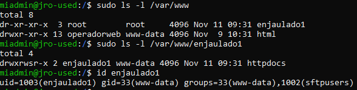

# USED – Ubuntu Server

*(Servidor de desarrollo para aplicaciones web basadas en el uso de PHP)*

**Guía de instalación y configuración: Ubuntu Server (`JRO-USED`)**

Esta guía describe, paso a paso, cómo montar desde cero un servidor de desarrollo web sobre una máquina virtual. Está escrita para dos tipos de lector:

- **Si ya conoces el tema:** todos los bloques de código se pueden copiar y pegar tal cual en la terminal y dejan la máquina exactamente igual que la original.
- **Si es la primera vez que lo ves:** cada paso explica antes *qué* se hace y *por qué*, y cada apartado termina con comprobaciones para saber que ha salido bien.

La documentación sigue el esquema propuesto:

| Bloque | Apartados | Qué contiene en esta guía |
|---|---|---|
| **Máquina** | Configuración inicial | Capítulos 1, 2 y 8 (sistema, red, cuentas) |
| **Servicio** | Instalación · Configuración · Monitorización · Mantenimiento | Capítulos 3 (Apache), 4 (PHP-FPM) y 5 (MariaDB) |
| **Software** | Instalación · Configuración · Ejemplo de uso | Capítulos 6 (phpMyAdmin) y 7 (Xdebug) |

> **¿Servicio o software?** Un *servicio* es un programa que se queda funcionando en segundo plano esperando peticiones (un "demonio": Apache, PHP-FPM, MariaDB). Por eso hay que vigilarlo (monitorización) y cuidarlo (mantenimiento). El *software* (phpMyAdmin, Xdebug) no vive por su cuenta: se apoya en los servicios anteriores, así que basta con instalarlo, configurarlo y saber usarlo.

---

## Ficha de la máquina

Todos los valores que se usan en la guía, reunidos en un solo sitio:

| Dato | Valor |
|---|---|
| Nombre de la máquina virtual | `JRO-USLimpia` (instalación) → `JRO-USED` (nombre definitivo) |
| Sistema operativo | Ubuntu Server 26.04 LTS (64 bits) |
| RAM / CPU | 2048 MB / 2 procesadores |
| Disco | 150 GB `/` · 4 GB `swap` · 350 GB `/var` |
| Red en clase (IES Los Sauces) | IP `10.199.8.97/22` · puerta de enlace `10.199.8.1` · DNS `10.151.123.21`, `10.151.126.21` |
| Red en casa | IP `192.168.1.100/24` · puerta de enlace `192.168.1.1` · DNS `8.8.8.8`, `8.8.4.4` |
| Zona horaria | `Europe/Madrid` |
| Cuentas de administración | `miadmin` / `paso` · `miadmin2` / `paso` |
| Cuentas de desarrollo | `operadorweb` / `paso` · `enjaulado1` / `paso` |
| Administrador de MariaDB | `adminsql` / `paso` (root de MariaDB: `paso`) |
| Versiones (repositorios de Ubuntu 26.04) | Apache 2.4 · PHP 8.5 (FPM) · MariaDB 11.8 · phpMyAdmin 5.2 · Xdebug 3 |
| Puertos abiertos | 22 (SSH/SFTP) · 80 (HTTP) · 443 (HTTPS) · 3306 (MariaDB) |
| Puerto de depuración | 9003 (Xdebug, sale del servidor hacia el PC del programador) |

> **Aviso de seguridad.** Esta es una máquina de **desarrollo**: contraseñas como `paso`, errores de PHP en pantalla, MariaDB accesible desde la red y certificado autofirmado son cómodos para aprender, pero **nunca** deben usarse en un servidor en explotación.

**Convenciones.** Los bloques `bash` se ejecutan en la terminal del servidor con el usuario `miadmin`. `sudo` ejecuta la orden como administrador y pedirá la contraseña (`paso`). En las pantallas de estado de `systemctl` se sale pulsando `q`.

---

## Índice de contenidos

- [1. Configuración inicial](#1-configuración-inicial)
  - [1.1. Preparación de la máquina virtual (VirtualBox)](#11-preparación-de-la-máquina-virtual-virtualbox)
  - [1.2. Instalación del sistema operativo (Ubuntu Server)](#12-instalación-del-sistema-operativo-ubuntu-server)
  - [1.3. Configuración de red definitiva (Netplan: clase y casa)](#13-configuración-de-red-definitiva-netplan-clase-y-casa)
  - [1.4. Actualización, nombre, zona horaria, SSH, cortafuegos y antivirus](#14-actualización-nombre-zona-horaria-ssh-cortafuegos-y-antivirus)
  - [1.5. Comprobación de la configuración inicial](#15-comprobación-de-la-configuración-inicial)
- [2. Cuentas de administración](#2-cuentas-de-administración)
  - [2.1. Cuentas administradoras (miadmin y miadmin2)](#21-cuentas-administradoras-miadmin-y-miadmin2)
  - [2.2. Comprobación de cuentas y permisos](#22-comprobación-de-cuentas-y-permisos)
- [3. Servicio: Apache](#3-servicio-apache)
  - [3.1. Instalación de Apache](#31-instalación-de-apache)
  - [3.2. Configuración de Apache](#32-configuración-de-apache)
  - [3.3. Monitorización de Apache](#33-monitorización-de-apache)
  - [3.4. Mantenimiento de Apache](#34-mantenimiento-de-apache)
- [4. Servicio: PHP-FPM](#4-servicio-php-fpm)
  - [4.1. Instalación de PHP-FPM](#41-instalación-de-php-fpm)
  - [4.2. Configuración de PHP-FPM](#42-configuración-de-php-fpm)
  - [4.3. Monitorización de PHP-FPM](#43-monitorización-de-php-fpm)
  - [4.4. Mantenimiento de PHP-FPM](#44-mantenimiento-de-php-fpm)
- [5. Servicio: MariaDB](#5-servicio-mariadb)
  - [5.1. Instalación de MariaDB](#51-instalación-de-mariadb)
  - [5.2. Configuración de MariaDB](#52-configuración-de-mariadb)
  - [5.3. Monitorización de MariaDB](#53-monitorización-de-mariadb)
  - [5.4. Mantenimiento de MariaDB](#54-mantenimiento-de-mariadb)
- [6. Software: phpMyAdmin](#6-software-phpmyadmin)
  - [6.1. Instalación de phpMyAdmin](#61-instalación-de-phpmyadmin)
  - [6.2. Configuración de phpMyAdmin](#62-configuración-de-phpmyadmin)
  - [6.3. Ejemplo de uso de phpMyAdmin](#63-ejemplo-de-uso-de-phpmyadmin)
- [7. Software: Xdebug](#7-software-xdebug)
  - [7.1. Instalación de Xdebug](#71-instalación-de-xdebug)
  - [7.2. Configuración de Xdebug](#72-configuración-de-xdebug)
  - [7.3. Ejemplo de uso de Xdebug](#73-ejemplo-de-uso-de-xdebug)
- [8. Cuentas de desarrollo](#8-cuentas-de-desarrollo)
  - [8.1. Usuario operador web (operadorweb)](#81-usuario-operador-web-operadorweb)
  - [8.2. Enjaulamiento de usuarios (SFTP)](#82-enjaulamiento-de-usuarios-sftp)
  - [8.3. Comprobación de las cuentas de desarrollo](#83-comprobación-de-las-cuentas-de-desarrollo)

---

## 1. Configuración inicial

En este capítulo se crea la máquina virtual, se instala el sistema operativo y se deja el servidor con red, hora, acceso remoto, cortafuegos y antivirus funcionando. Es la base sobre la que después se instalan los servicios.

### 1.1. Preparación de la máquina virtual (VirtualBox)

Una máquina virtual es un ordenador "simulado" dentro de tu ordenador real (el *anfitrión*). Permite tener un servidor completo sin necesitar otro equipo físico.

1. Abre **VirtualBox** y haz clic en **Nueva**.
2. **Nombre y sistema operativo:**
   - Nombre: `JRO-USLimpia`
   - Carpeta de máquina: *(tu preferencia)*
   - Tipo: `Linux`
   - Versión: `Ubuntu (64-bit)`
3. **Hardware:**
   - Memoria RAM: `2048 MB` (2 GB)
   - Procesadores (CPU): `2`
4. **Disco duro:**
   - Selecciona "Crear un disco duro virtual ahora".
   - Formato: `VDI (VirtualBox Disk Image)`, **reservado dinámicamente**.
   - Tamaño: `505 GB`. Debe caber `150 GB` (`/`) + `350 GB` (`/var`) + `4 GB` (`swap`) = 504 GB, más un pequeño margen para la partición de arranque que crea el instalador.
5. **Configuración de red (antes de iniciar):**
   - **En clase (IES Los Sauces – dominio de la Junta):** ve a **Configuración** de la máquina > **Red** y **deshabilita la tarjeta de red** (desmarca "Habilitar adaptador de red") antes de iniciar. Así el instalador no intenta conectarse a repositorios de Internet bloqueados por el DNS de la Junta, que es lo que provoca fallos en la instalación.
   - **En casa:** deja marcada "Habilitar adaptador de red" y selecciona **Adaptador puente (Bridged)** para que la máquina aparezca en la red de tu casa como un equipo más.

> **Dato útil.** "Reservado dinámicamente" significa que el archivo `.vdi` solo ocupa en tu disco real lo que la máquina vaya usando, no los 505 GB completos. Por eso se puede crear un disco tan grande en un portátil.

---

### 1.2. Instalación del sistema operativo (Ubuntu Server)

Inicia la máquina virtual seleccionando la ISO de **Ubuntu Server 26.04 LTS** (la versión recomendada por el profesor). *LTS* significa *Long Term Support*: versiones que salen cada dos años y reciben actualizaciones de seguridad durante al menos cinco, por eso son las que se usan en servidores.

1. **Idioma y teclado:** selecciona español.
2. **Conexión de red (clase):** como la tarjeta está deshabilitada, continúa sin red. Se configura a mano en el apartado 1.3.
3. **Almacenamiento (particionado manual):**
   - Selecciona **Custom storage layout** (personalizado).
   - Crea estas particiones en el disco libre:

     | Partición | Tamaño | Formato | Punto de montaje |
     |---|---|---|---|
     | 1 – Sistema | `150G` | `ext4` | `/` |
     | 2 – Intercambio | `4G` (RAM × 2) | `swap` | — |
     | 3 – Datos | `350G` | `ext4` | `/var` |

4. **Perfil (usuario principal):**
   - Nombre: `Juan`
   - Nombre del servidor: `JRO-USLimpia` *(si el instalador no admite mayúsculas, escribe `jro-uslimpia`)*
   - Nombre de usuario: `miadmin`
   - Contraseña: `paso`
5. **SSH Setup:** marca la casilla **"Install OpenSSH server"**.
6. Finaliza la instalación, **apaga la máquina virtual** y retira la ISO.

> **¿Por qué `/var` en una partición aparte?** En `/var` se guardan las páginas web (`/var/www`), las bases de datos (`/var/lib/mysql`) y los registros (`/var/log`), que es lo que más crece. Si se llena, el sistema (`/`) sigue teniendo espacio y el servidor no se bloquea. La `swap` es "memoria de reserva" en disco para cuando se agota la RAM.

---

### 1.3. Configuración de red definitiva (Netplan: clase y casa)

> **¡Atención!** Antes de volver a encender la máquina en clase, ve a VirtualBox > **Red** y **vuelve a habilitar el adaptador de red** como **Adaptador puente**.

Inicia sesión con el usuario `miadmin` y la contraseña `paso`.

Un servidor necesita una **IP fija** (estática): si cambiara cada día, nadie sabría dónde encontrarlo. En Ubuntu la red se define con **Netplan**, que lee archivos de texto en formato YAML dentro de `/etc/netplan/`.

**Paso 1 – Identificar la tarjeta de red y los archivos existentes**

```bash
# Ver el nombre de la tarjeta de red (en VirtualBox suele ser enp0s3)
ip -br a

# Ver qué archivos de configuración ha dejado el instalador
ls -l /etc/netplan/
```

> El nombre del archivo depende de la instalación: puede llamarse `00-installer-config.yaml` o `50-cloud-init.yaml`. Para que el resultado sea siempre el mismo, se guardan los archivos existentes como copia de seguridad y se crea uno propio y único. Si tu tarjeta no se llama `enp0s3`, cambia ese nombre en los archivos de abajo.

**Paso 2 – Copia de seguridad y limpieza**

```bash
# Guardar los archivos originales en una carpeta de copia de seguridad
sudo mkdir -p /etc/netplan/backup
sudo mv /etc/netplan/*.yaml /etc/netplan/backup/

# Impedir que cloud-init vuelva a generar la configuración de red al reiniciar
echo "network: {config: disabled}" | sudo tee /etc/cloud/cloud.cfg.d/99-disable-network-config.cfg
```

**Paso 3 – Crear la configuración (elige UNA de las dos opciones)**

*Opción A – CLASE (IES Los Sauces):*

```bash
sudo tee /etc/netplan/00-installer-config.yaml > /dev/null <<'EOF'
network:
  version: 2
  renderer: networkd
  ethernets:
    enp0s3:
      dhcp4: false
      addresses:
        - 10.199.8.97/22
      routes:
        - to: default
          via: 10.199.8.1
      nameservers:
        addresses: [10.151.123.21, 10.151.126.21]
EOF
```

*Opción B – CASA:*

```bash
sudo tee /etc/netplan/00-installer-config.yaml > /dev/null <<'EOF'
network:
  version: 2
  renderer: networkd
  ethernets:
    enp0s3:
      dhcp4: false
      addresses:
        - 192.168.1.100/24
      routes:
        - to: default
          via: 192.168.1.1
      nameservers:
        addresses: [8.8.8.8, 8.8.4.4]
EOF
```

**Paso 4 – Aplicar**

```bash
# Netplan exige que solo root pueda leer el archivo
sudo chmod 600 /etc/netplan/00-installer-config.yaml

# Comprobar que el archivo no tiene errores de sintaxis
sudo netplan generate

# Aplicar la configuración de red
sudo netplan apply
```

Para cambiar entre clase y casa basta con volver a ejecutar el bloque de la otra opción y repetir el paso 4.

| Parámetro | Qué significa |
|---|---|
| `addresses` | La IP del servidor y su máscara (`/22` = 1022 equipos posibles; `/24` = 254) |
| `routes … via` | La puerta de enlace: el router por el que se sale a otras redes |
| `nameservers` | Los servidores DNS, que traducen nombres (`ubuntu.com`) a direcciones IP |
| `dhcp4: false` | No pedir una IP automática; se usa la fija que hemos escrito |

> **Buenas prácticas.** YAML no admite tabuladores: la sangría se hace **siempre con espacios**. Si trabajas por SSH, usa `sudo netplan try` en lugar de `apply`: aplica los cambios y los deshace solos a los 120 segundos si no confirmas, de modo que un error no te deja sin conexión.

---

### 1.4. Actualización, nombre, zona horaria, SSH, cortafuegos y antivirus

**1. Actualizar el sistema operativo**

Lo primero en cualquier servidor recién instalado: `update` descarga la lista de paquetes disponibles y `upgrade` instala las versiones nuevas (incluidos los parches de seguridad).

```bash
sudo apt update && sudo apt upgrade -y
```

**2. Nombre definitivo de la máquina**

La máquina se instaló como `JRO-USLimpia` (máquina "limpia"). Al convertirla en el servidor de desarrollo se le pone su nombre definitivo, `JRO-USED`:

```bash
# Cambiar el nombre de la máquina
sudo hostnamectl set-hostname JRO-USED

# Sustituir el nombre antiguo por el nuevo en /etc/hosts
sudo sed -i 's/jro-uslimpia/JRO-USED/Ig' /etc/hosts

# Comprobar: debe aparecer una línea "127.0.1.1 JRO-USED"
cat /etc/hosts
```

> Si en `/etc/hosts` no aparece el nombre nuevo, edítalo con `sudo nano /etc/hosts` y deja la línea `127.0.1.1 JRO-USED`. Si falta, `sudo` muestra el aviso "unable to resolve host" en cada orden.

**3. Fecha y hora**

Una hora correcta es imprescindible: los registros (logs), los certificados HTTPS y las copias de seguridad dependen de ella.

```bash
timedatectl status
sudo timedatectl set-timezone Europe/Madrid
```

**4. SSH (acceso remoto)**

SSH permite manejar el servidor desde otro equipo con una conexión cifrada. Es la forma normal de trabajar: un servidor real no tiene pantalla ni teclado.

```bash
# Instalar SSH (solo hace algo si no se marcó la casilla durante la instalación)
sudo apt install openssh-server -y
```

**5. Cortafuegos UFW**

UFW (*Uncomplicated Firewall*) cierra todos los puertos de entrada salvo los que se abran expresamente. Regla de oro: **permitir SSH antes de activar el cortafuegos**, o te quedarás fuera.

```bash
# No se usa IPv6: se desactiva para que UFW no cree reglas duplicadas "(v6)"
sudo sed -i 's/^IPV6=yes/IPV6=no/' /etc/default/ufw

# Permitir SSH y activar el cortafuegos (responde "y" a la pregunta)
sudo ufw allow OpenSSH
sudo ufw enable
sudo ufw status
```

> **Cambio respecto a la versión anterior.** Antes se borraba la regla IPv6 a mano con `sudo ufw delete 2`. El problema es que cada puerto que se abre después (Apache, MariaDB) vuelve a crear su regla "(v6)". Con `IPV6=no` no se crea ninguna y el resultado es el mismo sin tener que repetir el borrado.

**6. Antivirus ClamAV**

ClamAV es un antivirus libre. En un servidor web sirve sobre todo para analizar los archivos que suben los usuarios.

```bash
# Instalar el antivirus y su demonio
sudo apt install clamav clamav-daemon -y

# Parar el actualizador automático para poder actualizar a mano la primera vez
sudo systemctl stop clamav-freshclam
sudo freshclam

# Volver a iniciar y dejar habilitada la actualización automática de firmas
sudo systemctl start clamav-freshclam
sudo systemctl enable clamav-freshclam

# Iniciar el demonio del antivirus (necesita las firmas ya descargadas)
sudo systemctl enable --now clamav-daemon
```

> **Dato útil.** `clamav-daemon` carga todas las firmas de virus en memoria y consume alrededor de 1 GB de RAM. Con 2 GB en la máquina es normal notar que la memoria libre baja bastante.

**7. Servicio SFTP de SSH (preparación para usuarios enjaulados)**

SFTP es la transferencia de archivos que viaja por SSH (sustituye al antiguo FTP, que no cifra nada). Aquí se configura para que los usuarios del grupo `sftpusers` queden **enjaulados**: solo verán su propia carpeta y no podrán abrir una terminal. El grupo y el usuario se crean en el [capítulo 8](#82-enjaulamiento-de-usuarios-sftp).

```bash
# Copia de seguridad del archivo de configuración
sudo cp /etc/ssh/sshd_config /etc/ssh/sshd_config.backup

# Comentar la línea original del subsistema SFTP
sudo sed -i 's|^Subsystem\s\+sftp\s\+/usr/lib/openssh/sftp-server|#&|' /etc/ssh/sshd_config

# Añadir al FINAL del archivo la nueva configuración
sudo tee -a /etc/ssh/sshd_config > /dev/null <<'EOF'

# --- SFTP con usuarios enjaulados ---
Subsystem sftp internal-sftp

Match Group sftpusers
    ChrootDirectory %h
    ForceCommand internal-sftp -u 0002
    AllowTcpForwarding no
    PermitTunnel no
    X11Forwarding no
EOF

# Comprobar la sintaxis (si no muestra nada, está bien) y reiniciar
sudo sshd -t
sudo systemctl restart ssh
```

| Directiva | Qué hace |
|---|---|
| `Subsystem sftp internal-sftp` | Usa el servidor SFTP integrado en SSH, que funciona dentro de una jaula sin necesitar más archivos |
| `Match Group sftpusers` | Lo que sigue solo se aplica a los miembros del grupo `sftpusers` |
| `ChrootDirectory %h` | Encierra al usuario en su directorio personal (`%h` = *home*) |
| `ForceCommand internal-sftp -u 0002` | Solo permite SFTP (sin terminal). `-u 0002` hace que los archivos subidos tengan permiso de escritura para el grupo, para que Apache pueda trabajar con ellos |
| `AllowTcpForwarding no`, `PermitTunnel no`, `X11Forwarding no` | Desactivan túneles y reenvíos, que permitirían saltarse la jaula |

> **Corrección.** En la versión anterior figuraba `AllowTcpForwarding yes`. En una jaula se pone en `no`: con `yes`, un usuario enjaulado podría usar el servidor como puente hacia otros equipos de la red. Además, el bloque `Match` debe ir **al final** del archivo, porque todo lo que se escriba debajo queda dentro de él.

---

### 1.5. Comprobación de la configuración inicial

```bash
# Nombre de la máquina y versión del sistema
hostnamectl
uname -a

# IP asignada y configuración de red aplicada
ip a
sudo cat /etc/netplan/00-installer-config.yaml

# Salida a la red: puerta de enlace y resolución de nombres
ping -c 3 10.199.8.1
ping -c 3 ubuntu.com

# Discos, particiones y tamaños (/, /var y swap)
lsblk
df -h
swapon --show

# Fecha, hora y zona horaria
timedatectl status

# Procesos en ejecución y ruta actual
ps
pwd

# Estado del servicio SSH y sintaxis de su configuración
sudo systemctl status ssh
sudo sshd -t

# Estado del cortafuegos
sudo systemctl status ufw
sudo ufw status

# Estado del antivirus
sudo systemctl status clamav-daemon
sudo systemctl status clamav-freshclam
```

*(En casa, sustituye `10.199.8.1` por `192.168.1.1` en el `ping`.)*

**Prueba de acceso remoto**, desde una terminal del equipo anfitrión:

```bash
ssh miadmin@10.199.8.97
```

> La primera vez, SSH pregunta si confías en la huella del servidor: responde `yes`. Si `systemctl status ssh` muestra el servicio inactivo pero la conexión funciona, es normal: Ubuntu arranca SSH "bajo demanda" (`ssh.socket`) cuando llega la primera conexión.

---

## 2. Cuentas de administración

### 2.1. Cuentas administradoras (miadmin y miadmin2)

En Linux nunca se trabaja directamente como `root` (el superusuario). Se usan cuentas normales que pertenecen al grupo `sudo` y que elevan privilegios solo cuando hace falta. Además de `miadmin` (creada durante la instalación) se crea una segunda cuenta administradora, `miadmin2`: si una se bloquea o se olvida su contraseña, siempre queda otra para entrar.

```bash
# Crear miadmin2 con contraseña "paso"
sudo adduser --disabled-password --gecos "" miadmin2
echo 'miadmin2:paso' | sudo chpasswd

# Darle exactamente los mismos grupos que tiene miadmin (sudo, adm, cdrom, dip, plugdev, lxd...)
for g in $(id -Gn miadmin); do [ "$g" != "miadmin" ] && sudo usermod -aG "$g" miadmin2; done
```

> **Explicación.** `adduser` crea el usuario con su carpeta en `/home`; `chpasswd` le pone la contraseña sin preguntar. El bucle recorre los grupos de `miadmin` y añade a `miadmin2` a cada uno. La opción `-aG` **añade** grupos; sin la `-a`, `usermod -G` *sustituye* los grupos que el usuario ya tenía (un error muy habitual). El grupo importante es `sudo`: es el que da permisos de administración.

---

### 2.2. Comprobación de cuentas y permisos

```bash
# Usuarios y grupos a los que pertenecen (ambos deben estar en "sudo")
id miadmin
grep miadmin /etc/passwd
grep miadmin /etc/group

id miadmin2

# Probar que miadmin2 puede administrar (pide su contraseña: paso; debe responder "root")
su - miadmin2 -c "sudo whoami"
```

*(La comprobación de `operadorweb` y del directorio web está en el [apartado 8.3](#83-comprobación-de-las-cuentas-de-desarrollo), una vez creada la cuenta.)*

---

## 3. Servicio: Apache

**Apache HTTP Server** es el servidor web: el programa que recibe las peticiones de los navegadores y devuelve las páginas. Existe desde 1995 y sigue siendo uno de los más usados del mundo. En Ubuntu el servicio se llama `apache2`.

### 3.1. Instalación de Apache

```bash
sudo apt install apache2 -y
```

Tras instalarlo, el servicio queda arrancado y habilitado (se inicia solo con la máquina). Lo que conviene conocer:

| Ruta | Para qué sirve |
|---|---|
| `/var/www/html` | *DocumentRoot*: la carpeta cuyas páginas se publican |
| `/etc/apache2/apache2.conf` | Configuración general |
| `/etc/apache2/sites-available/` | Sitios (*VirtualHost*) definidos; se activan con `a2ensite` |
| `/etc/apache2/mods-available/` | Módulos disponibles; se activan con `a2enmod` |
| `/etc/apache2/conf-available/` | Configuraciones extra; se activan con `a2enconf` |
| `/var/log/apache2/` | Registros de accesos y errores |

---

### 3.2. Configuración de Apache

#### 3.2.1. Cortafuegos y módulos

```bash
# Permitir tráfico HTTP (80) y HTTPS (443) en el cortafuegos
sudo ufw allow 'Apache Full'

# Activar los módulos SSL (HTTPS) y rewrite (redirecciones)
sudo a2enmod ssl rewrite
```

#### 3.2.2. Nombre del servidor (ServerName)

Sin esta directiva Apache muestra un aviso en cada arranque (*"Could not reliably determine the server's fully qualified domain name"*). Se define en un archivo propio, sin tocar `apache2.conf`:

```bash
echo "ServerName JRO-USED" | sudo tee /etc/apache2/conf-available/servername.conf
sudo a2enconf servername
```

#### 3.2.3. Página de error personalizada

Cuando alguien pide una página que no existe, Apache devuelve el error **404**. En vez de la página por defecto se mostrará una propia:

```bash
# Crear la carpeta y la página de error
sudo mkdir -p /var/www/html/webroot/error
sudo tee /var/www/html/webroot/error/error404.html > /dev/null <<'EOF'
<!DOCTYPE html>
<html lang="es">
<head>
    <meta charset="UTF-8">
    <title>Error 404 - Página no encontrada</title>
</head>
<body>
    <h1>Error 404</h1>
    <p>La página que buscas no existe en el servidor JRO-USED.</p>
    <p><a href="/">Volver al inicio</a></p>
</body>
</html>
EOF
```

#### 3.2.4. Sitio HTTP (puerto 80)

```bash
# Copia de seguridad del archivo original
sudo cp /etc/apache2/sites-available/000-default.conf /etc/apache2/sites-available/000-default.conf.backup

# Nueva configuración del sitio HTTP
sudo tee /etc/apache2/sites-available/000-default.conf > /dev/null <<'EOF'
<VirtualHost *:80>
    ServerAdmin webmaster@localhost
    DocumentRoot /var/www/html

    ErrorDocument 404 /webroot/error/error404.html

    ErrorLog ${APACHE_LOG_DIR}/error.log
    CustomLog ${APACHE_LOG_DIR}/access.log combined
</VirtualHost>
EOF
```

#### 3.2.5. Certificado y clave autofirmados

HTTPS cifra la comunicación entre el navegador y el servidor. Para ello hace falta un **certificado** (público) y una **clave privada** (secreta).

Un certificado autofirmado cifra igual que uno "de verdad", pero no está firmado por ninguna autoridad certificadora de confianza de las que traen los navegadores, así que estos no pueden validar automáticamente la identidad del servidor. Por eso la primera vez aparece un aviso de seguridad, que en un entorno de desarrollo se acepta sin problema.

```bash
sudo openssl req -x509 -nodes -days 365 -newkey rsa:2048 \
  -keyout /etc/ssl/private/apache-selfsigned.key \
  -out /etc/ssl/certs/apache-selfsigned.crt \
  -subj "/CN=10.199.8.97" \
  -addext "subjectAltName = IP:10.199.8.97,IP:192.168.1.100"
```

| Parte del comando | Significado |
|---|---|
| `openssl` | La utilidad para trabajar con criptografía y certificados |
| `req` | Módulo de gestión de solicitudes de certificado |
| `-x509` | Genera directamente un certificado X.509 autofirmado |
| `-nodes` | La clave privada se guarda **sin** contraseña (*passphrase*), para que Apache pueda arrancar sin que nadie la teclee |
| `-days 365` | Válido durante 365 días |
| `-newkey rsa:2048` | Crea una clave RSA nueva de 2048 bits |
| `-keyout` | Ruta donde se guarda la clave privada |
| `-out` | Ruta donde se guarda el certificado |
| `-subj "/CN=…"` | Nombre al que pertenece el certificado (la IP del servidor), sin hacer preguntas |
| `-addext "subjectAltName…"` | Direcciones para las que vale el certificado. Se incluyen la IP de clase y la de casa para que sirva en los dos sitios |

> **Corrección.** La versión anterior decía que `-nodes` genera la clave "mediante una passphrase"; es justo al revés: significa *no DES*, es decir, **sin cifrar** la clave con contraseña.

#### 3.2.6. Sitio HTTPS (puerto 443)

```bash
# Copia de seguridad del archivo original
sudo cp /etc/apache2/sites-available/default-ssl.conf /etc/apache2/sites-available/default-ssl.conf.backup

# Nueva configuración del sitio HTTPS
sudo tee /etc/apache2/sites-available/default-ssl.conf > /dev/null <<'EOF'
<VirtualHost *:443>
    ServerAdmin webmaster@localhost
    ServerName 10.199.8.97
    DocumentRoot /var/www/html

    SSLEngine on
    SSLCertificateFile /etc/ssl/certs/apache-selfsigned.crt
    SSLCertificateKeyFile /etc/ssl/private/apache-selfsigned.key

    ErrorDocument 404 /webroot/error/error404.html

    ErrorLog ${APACHE_LOG_DIR}/daw-ssl-error.log
    CustomLog ${APACHE_LOG_DIR}/daw-ssl-access.log combined
</VirtualHost>
EOF

# Activar el sitio HTTPS
sudo a2ensite default-ssl.conf
```

#### 3.2.7. Redirección de HTTP a HTTPS

El objetivo es que quien entre por `http://` acabe automáticamente en `https://`. Se hace con un archivo `.htaccess`, que permite cambiar la configuración de una carpeta sin tocar los archivos generales de Apache.

**Permitir el uso de `.htaccess`** (por defecto Apache los ignora):

```bash
# Cambiar "AllowOverride None" por "AllowOverride All" solo en el bloque de /var/www/
sudo sed -i '/<Directory \/var\/www\/>/,/<\/Directory>/ s/AllowOverride None/AllowOverride All/' /etc/apache2/apache2.conf
```

El bloque de `/etc/apache2/apache2.conf` debe quedar así:

```apache
<Directory /var/www/>
    Options Indexes FollowSymLinks
    AllowOverride All
    Require all granted
</Directory>
```

**Crear el archivo `.htaccess` en el DocumentRoot** (`/var/www/html/.htaccess`):

```bash
sudo tee /var/www/html/.htaccess > /dev/null <<'EOF'
RewriteEngine On
RewriteCond %{SERVER_PORT} 80
RewriteRule ^(.*)$ https://%{HTTP_HOST}/$1 [R=301,L]
EOF
```

> Este archivo y la página de error se crean ahora con `sudo`; en el [capítulo 8](#81-usuario-operador-web-operadorweb) todo el contenido de `/var/www/html` pasa a ser propiedad de `operadorweb`, que será quien lo gestione a partir de entonces.

| Directiva | Qué hace |
|---|---|
| `RewriteEngine On` | Habilita `mod_rewrite` en esta carpeta |
| `RewriteCond %{SERVER_PORT} 80` | Condición: la regla solo se aplica a las peticiones que llegan al puerto 80 (HTTP) |
| `RewriteRule` | Define la regla. La primera cadena describe cómo es la URL original; la segunda, la URL nueva |
| `^(.*)$` | Expresión regular que captura todo lo que va después de la dirección del servidor |
| `%{HTTP_HOST}` | La dirección que el visitante escribió. Así la redirección funciona igual en clase (`10.199.8.97`) y en casa (`192.168.1.100`) sin cambiar el archivo |
| `$1` | Sustituye lo capturado entre paréntesis: cada subpágina se redirige a la misma subpágina y no a la portada |
| `[R=301,L]` | `R=301` hace una redirección permanente; `L` (*last*) indica que no se apliquen más reglas después de esta |

> **Nota.** `mod_rewrite` necesita la opción `FollowSymLinks`, que ya viene activada en el bloque `<Directory /var/www/>`, por eso no hace falta escribir `Options +FollowSymLinks` en el `.htaccess`.

#### 3.2.8. Validar y aplicar

```bash
# Comprobar que no haya errores en la configuración (debe responder "Syntax OK")
sudo apache2ctl configtest

# Reiniciar Apache para aplicar todos los cambios
sudo systemctl restart apache2
```

> **Buena práctica.** Ejecuta **siempre** `configtest` antes de reiniciar. Si hay un error de sintaxis y reinicias, Apache no arranca y todas las webs quedan caídas.

---

### 3.3. Monitorización de Apache

Monitorizar es comprobar que el servicio está vivo, que escucha donde debe y qué está ocurriendo en él.

```bash
# Estado del servicio (debe aparecer "active (running)")
sudo systemctl status apache2

# Puertos en los que escucha (deben aparecer el 80 y el 443)
sudo ss -tlpn | grep apache2

# Regla "Apache Full" activa en el cortafuegos
sudo ufw status

# Módulos cargados (deben estar ssl_module y rewrite_module)
sudo apache2ctl -M

# Sitios (VirtualHost) activos
sudo apache2ctl -S

# Respuesta del servidor: HTTP debe dar "301" (redirección) y HTTPS "200"
curl -I http://localhost
curl -kI https://localhost

# La página de error personalizada: debe dar "404"
curl -kI https://localhost/noexiste
```

**Registros (logs).** Son la primera fuente de información cuando algo falla:

```bash
# Ver los accesos en tiempo real (Ctrl+C para salir)
sudo tail -f /var/log/apache2/access.log /var/log/apache2/daw-ssl-access.log

# Ver los últimos errores
sudo tail -n 50 /var/log/apache2/error.log /var/log/apache2/daw-ssl-error.log

# Mensajes del servicio registrados por el sistema
sudo journalctl -u apache2 --since today
```

**Comprobación web.** Desde el navegador del equipo anfitrión:

- `http://10.199.8.97` → debe redirigir a `https://10.199.8.97` y mostrar la página por defecto de Apache2 (tras aceptar el aviso del certificado).
- `https://10.199.8.97/noexiste` → debe mostrar la página de error 404 personalizada.

---

### 3.4. Mantenimiento de Apache

| Tarea | Orden |
|---|---|
| Recargar la configuración **sin cortar** las conexiones | `sudo systemctl reload apache2` |
| Reiniciar por completo (necesario al activar módulos) | `sudo systemctl restart apache2` |
| Parar / arrancar | `sudo systemctl stop apache2` / `sudo systemctl start apache2` |
| Arranque automático con la máquina | `sudo systemctl enable apache2` |
| Activar / desactivar un sitio | `sudo a2ensite sitio` / `sudo a2dissite sitio` |
| Activar / desactivar un módulo | `sudo a2enmod modulo` / `sudo a2dismod modulo` |
| Actualizar el servicio | `sudo apt update && sudo apt upgrade -y` |

**Copia de seguridad de la configuración** (antes de cualquier cambio importante):

```bash
sudo tar -czf ~/apache2-config-$(date +%F).tar.gz /etc/apache2
```

**Renovación del certificado.** El certificado autofirmado caduca a los 365 días:

```bash
# Ver la fecha de caducidad
sudo openssl x509 -in /etc/ssl/certs/apache-selfsigned.crt -noout -enddate
```

Cuando caduque, se repite el comando `openssl req …` del apartado 3.2.5 y se ejecuta `sudo systemctl reload apache2`.

**Registros.** No hay que borrarlos a mano: `logrotate` los rota y comprime automáticamente (configuración en `/etc/logrotate.d/apache2`). Sí conviene vigilar el espacio de `/var` con `df -h /var`.

**Si Apache no arranca:** `sudo apache2ctl configtest` indica el archivo y la línea del error; `sudo journalctl -u apache2 -n 30` muestra el motivo del fallo.

---

## 4. Servicio: PHP-FPM

**PHP** es el lenguaje con el que se programan las aplicaciones web de este servidor. **PHP-FPM** (*FastCGI Process Manager*) es el servicio que ejecuta ese código: Apache recibe la petición y, si es un archivo `.php`, se lo pasa a PHP-FPM, que devuelve el resultado.

> **¿Por qué FPM y no el módulo clásico de Apache (`mod_php`)?** Con FPM, PHP funciona como un servicio independiente: consume menos memoria, se puede reiniciar sin tocar Apache y permite que Apache use su modo de trabajo más eficiente. Es la forma recomendada actualmente.

### 4.1. Instalación de PHP-FPM

```bash
# Instalar PHP 8.5 con FPM (la versión de los repositorios de Ubuntu 26.04)
sudo apt install php8.5-fpm -y
```

---

### 4.2. Configuración de PHP-FPM

#### 4.2.1. Integración con Apache

```bash
# Módulos de Apache necesarios para hablar con PHP-FPM
sudo a2enmod proxy_fcgi setenvif

# Activar la configuración que envía los archivos .php a PHP-FPM
sudo a2enconf php8.5-fpm

# Reiniciar ambos servicios
sudo systemctl restart php8.5-fpm
sudo systemctl restart apache2
```

#### 4.2.2. Ajustes para desarrollo

Por defecto PHP viene configurado para producción (oculta los errores). En desarrollo interesa lo contrario: ver todos los errores en pantalla y tener límites más amplios.

Los ajustes se escriben en un archivo propio dentro de `conf.d`, que PHP carga después de `php.ini` y por tanto tiene prioridad. Así el `php.ini` original queda intacto y todos los cambios están localizados en un único archivo:

```bash
sudo tee /etc/php/8.5/fpm/conf.d/99-desarrollo.ini > /dev/null <<'EOF'
; Ajustes para el entorno de DESARROLLO (JRO-USED)
display_errors = On
error_reporting = E_ALL
display_startup_errors = On
file_uploads = On
allow_url_fopen = On
memory_limit = 256M
upload_max_filesize = 100M
post_max_size = 100M
max_execution_time = 360
date.timezone = Europe/Madrid
EOF

# Aplicar los cambios
sudo systemctl restart php8.5-fpm
```

| Directiva | Qué hace |
|---|---|
| `display_errors = On` | Muestra los errores en la página (imprescindible para depurar; **nunca** en producción) |
| `error_reporting = E_ALL` | Informa de todos los errores, avisos y obsolescencias |
| `display_startup_errors = On` | Muestra también los errores que ocurren al arrancar PHP |
| `file_uploads = On` | Permite subir archivos mediante formularios |
| `allow_url_fopen = On` | Permite abrir URLs como si fueran archivos |
| `memory_limit = 256M` | Memoria máxima que puede usar un script |
| `upload_max_filesize = 100M` | Tamaño máximo de cada archivo subido |
| `post_max_size = 100M` | Tamaño máximo de un envío completo; debe ser igual o mayor que el anterior o las subidas grandes fallan |
| `max_execution_time = 360` | Segundos que puede durar un script antes de cortarse |
| `date.timezone = Europe/Madrid` | Zona horaria que usan las funciones de fecha |

> **Correcciones.** En la versión anterior se indicaba editar `/etc/php/8.5/fpm/conf.d`, que es una **carpeta**, no un archivo; el archivo general es `/etc/php/8.5/fpm/php.ini`. Además, dos directivas tenían guion en lugar de guion bajo (`file-uploads`, `allow-url_fopen`): PHP las ignoraba sin avisar. Se añade `post_max_size`, sin la cual `upload_max_filesize = 100M` no tiene efecto real (su valor por defecto es 8M).
>
> Si prefieres el método clásico, puedes cambiar esos mismos valores con `sudo nano /etc/php/8.5/fpm/php.ini` (usa `Ctrl+W` para buscar cada directiva).

---

### 4.3. Monitorización de PHP-FPM

```bash
# Estado del servicio
sudo systemctl status php8.5-fpm

# Versión instalada
php -v

# Comprobar la sintaxis de la configuración de FPM (debe responder "test is successful")
sudo php-fpm8.5 -t

# Módulos de PHP cargados
php -m

# Registro del servicio
sudo tail -n 30 /var/log/php8.5-fpm.log
sudo journalctl -u php8.5-fpm --since today

# Confirmar que Apache tiene activa la integración con FPM
sudo apache2ctl -M | grep proxy_fcgi
ls /etc/apache2/conf-enabled/ | grep php
```

**Prueba real con `phpinfo()`.** Es la forma de ver la configuración que usa PHP-FPM de verdad:

```bash
# Crear una página de prueba
echo '<?php phpinfo();' | sudo tee /var/www/html/info.php

# Debe aparecer "FPM/FastCGI" como Server API
curl -ks https://localhost/info.php | grep -i "Server API"

# Comprobar que se han aplicado los ajustes de desarrollo
curl -ks https://localhost/info.php | grep -iE "display_errors|memory_limit|upload_max_filesize"
```

También puedes abrir `https://10.199.8.97/info.php` en el navegador. **Al terminar, borra el archivo**, porque muestra información interna del servidor:

```bash
sudo rm /var/www/html/info.php
```

> **Ojo con esto.** PHP tiene configuraciones separadas para la terminal (`/etc/php/8.5/cli/`) y para FPM (`/etc/php/8.5/fpm/`). `php -i` o `php --ini` en la terminal muestran la de **CLI**, no la de la web. Para saber qué usa la web, la referencia es `phpinfo()`.

---

### 4.4. Mantenimiento de PHP-FPM

| Tarea | Orden |
|---|---|
| Aplicar cambios de configuración | `sudo systemctl restart php8.5-fpm` |
| Recargar sin cortar peticiones en curso | `sudo systemctl reload php8.5-fpm` |
| Buscar extensiones disponibles | `apt search php8.5-` |
| Instalar una extensión | `sudo apt install php8.5-NOMBRE -y` |
| Activar / desactivar una extensión | `sudo phpenmod NOMBRE` / `sudo phpdismod NOMBRE` |
| Actualizar PHP | `sudo apt update && sudo apt upgrade -y` |

Reglas a recordar:

- **Todo cambio en la configuración de PHP o en sus extensiones exige reiniciar `php8.5-fpm`**, no Apache. Es el olvido más habitual: se cambia un valor, se reinicia Apache y "no funciona".
- Para volver a los valores originales basta con borrar `/etc/php/8.5/fpm/conf.d/99-desarrollo.ini` y reiniciar el servicio.
- Si la máquina pasara a producción: `display_errors = Off` y los errores se consultan en los registros.

---

## 5. Servicio: MariaDB

**MariaDB** es el sistema gestor de bases de datos: guarda la información de las aplicaciones (usuarios, productos, pedidos…) y la devuelve cuando PHP se la pide mediante consultas SQL.

> **Curiosidad.** MariaDB nació en 2009 como bifurcación de MySQL, creada por su autor original, Michael "Monty" Widenius, cuando Oracle compró MySQL. MySQL lleva el nombre de su hija My; MariaDB, el de su hija María. Son compatibles entre sí: por eso los comandos, el puerto (3306) y muchas rutas (`/etc/mysql`) conservan el nombre "mysql".

### 5.1. Instalación de MariaDB

```bash
sudo apt update

# Instalar el servidor de MariaDB
sudo apt install mariadb-server -y
```

---

### 5.2. Configuración de MariaDB

#### 5.2.1. Instalación segura

MariaDB incluye un asistente que elimina las opciones inseguras que vienen por defecto:

```bash
sudo mariadb-secure-installation
```

**Responde de la siguiente forma:**

| Pregunta | Respuesta |
|---|---|
| Contraseña actual de root (vacía por defecto) | *pulsa ENTER* |
| Cambiar a autenticación `unix_socket` | `Y` |
| Cambiar la contraseña de root | `Y` |
| Nueva contraseña (y repetirla) | `paso` |
| Eliminar usuarios anónimos | `Y` |
| No permitir a root iniciar sesión remotamente | `Y` |
| Eliminar la base de datos "test" | `Y` |
| Recargar privilegios | `Y` |

> **¿Qué es `unix_socket`?** Es un método de autenticación por el que MariaDB confía en el usuario del sistema operativo: quien ya es `root` en Linux (`sudo mariadb`) entra sin contraseña. Por eso `root` solo sirve desde la propia máquina y para trabajar en remoto se crea un usuario aparte.

#### 5.2.2. Creación del usuario administrador

```bash
# Entrar en MariaDB como administrador
sudo mariadb
```

Ya dentro de MariaDB (el indicador cambia a `MariaDB [(none)]>`):

```sql
-- Crear el usuario (el % significa "desde cualquier equipo")
CREATE USER 'adminsql'@'%' IDENTIFIED BY 'paso';

-- Darle todos los privilegios sobre todas las bases de datos
GRANT ALL ON *.* TO 'adminsql'@'%' WITH GRANT OPTION;

-- Comprobar que se ha creado correctamente
SELECT User, Host FROM mysql.user;

-- Salir de MariaDB
exit
```

#### 5.2.3. Permitir conexiones desde la red

Por defecto MariaDB solo atiende conexiones desde la propia máquina (`127.0.0.1`). Para poder conectarse desde el PC del programador se le indica que escuche en todas las direcciones (`0.0.0.0`):

```bash
# Copia de seguridad del archivo de configuración
sudo cp /etc/mysql/mariadb.conf.d/50-server.cnf /etc/mysql/mariadb.conf.d/50-server.cnf.backup

# Cambiar "bind-address = 127.0.0.1" por "bind-address = 0.0.0.0"
sudo sed -i 's/^bind-address\s*=.*/bind-address = 0.0.0.0/' /etc/mysql/mariadb.conf.d/50-server.cnf

# Comprobar el cambio
grep bind-address /etc/mysql/mariadb.conf.d/50-server.cnf

# Reiniciar para aplicar el cambio
sudo systemctl restart mariadb
```

> **Corrección.** En la versión anterior faltaba el reinicio del servicio: sin él, el cambio de `bind-address` no se aplica y MariaDB sigue aceptando solo conexiones locales.

#### 5.2.4. Abrir el puerto en el cortafuegos

```bash
# Abrir el puerto de MariaDB/MySQL (3306)
sudo ufw allow 3306/tcp
```

#### 5.2.5. Extensión de MySQL/MariaDB para PHP

Para que PHP pueda hablar con MariaDB necesita su extensión (incluye `mysqli` y `PDO`, que es la que se usa para programar):

```bash
# Instalar la extensión
sudo apt install php8.5-mysql -y

# Reiniciar PHP-FPM para que la cargue
sudo systemctl restart php8.5-fpm
```

---

### 5.3. Monitorización de MariaDB

```bash
# Estado del servicio
sudo systemctl status mariadb

# Puerto en el que escucha (debe aparecer 0.0.0.0:3306)
sudo ss -tlpn | grep mariadbd

# Puerto abierto en el cortafuegos
sudo ufw status

# Resumen rápido: tiempo activo, conexiones, consultas por segundo
sudo mariadb-admin status

# Versión del servidor
sudo mariadb -e "SELECT VERSION();"

# Conexiones abiertas y qué está haciendo cada una
sudo mariadb -e "SHOW PROCESSLIST;"

# Bases de datos y usuarios existentes
sudo mariadb -e "SHOW DATABASES; SELECT User, Host FROM mysql.user;"

# Registro del servicio
sudo journalctl -u mariadb --since today

# Extensiones de PHP para MariaDB cargadas (deben aparecer mysqli y pdo_mysql)
php -m | grep -i mysql
```

**Prueba de conexión con el usuario creado** (pide la contraseña: `paso`):

```bash
mariadb -h 10.199.8.97 -u adminsql -p -e "SELECT CURRENT_USER();"
```

Si responde `adminsql@%`, el usuario, la escucha en red y el cortafuegos funcionan. *(En casa, usa `192.168.1.100`.)*

---

### 5.4. Mantenimiento de MariaDB

**Copias de seguridad.** Es la tarea de mantenimiento más importante de cualquier base de datos:

```bash
# Copia de TODAS las bases de datos en un archivo con la fecha de hoy
sudo mariadb-dump --all-databases > ~/copia-mariadb-$(date +%F).sql

# Copia de una sola base de datos (ejemplo: DBPrueba)
sudo mariadb-dump DBPrueba > ~/DBPrueba-$(date +%F).sql

# Restaurar una copia completa (sustituye FECHA por la del archivo)
sudo mariadb < ~/copia-mariadb-FECHA.sql
```

**Otras tareas habituales:**

| Tarea | Orden |
|---|---|
| Reiniciar tras cambiar la configuración | `sudo systemctl restart mariadb` |
| Revisar y reparar todas las tablas | `sudo mariadb-check --all-databases` |
| Optimizar todas las tablas | `sudo mariadb-check --optimize --all-databases` |
| Cambiar la contraseña de un usuario | `sudo mariadb -e "ALTER USER 'adminsql'@'%' IDENTIFIED BY 'nueva';"` |
| Ver los privilegios de un usuario | `sudo mariadb -e "SHOW GRANTS FOR 'adminsql'@'%';"` |
| Actualizar el servicio | `sudo apt update && sudo apt upgrade -y` |

> **Buena práctica.** En un servidor real cada aplicación tiene su propio usuario con permisos **solo sobre su base de datos**, y el puerto 3306 no se abre a toda la red. Un usuario con todos los privilegios y accesible desde cualquier equipo, como `adminsql`, solo es aceptable en desarrollo.

---

## 6. Software: phpMyAdmin

**phpMyAdmin** es una aplicación web, escrita en PHP, para administrar MariaDB desde el navegador: crear bases de datos y tablas, lanzar consultas, importar y exportar datos… sin escribir órdenes en la terminal. No es un servicio: son páginas PHP que sirve Apache y ejecuta PHP-FPM.

### 6.1. Instalación de phpMyAdmin

```bash
sudo apt install phpmyadmin php-mbstring php-zip php-gd php-curl -y
```

**¡Atención! Durante la instalación aparecen varias pantallas. Sigue estos pasos:**

1. **Servidor web a configurar:** marca `apache2`.
   - **Pulsa la barra espaciadora** para seleccionarlo: debe aparecer un asterisco `[*]`. Si solo pulsas ENTER, no se selecciona y phpMyAdmin no quedará enlazado con Apache.
   - Pulsa **TAB** y después **ENTER**.
2. **¿Configurar la base de datos con dbconfig-common?:** `Yes`.
3. **Contraseña de la aplicación phpMyAdmin:** `paso`
4. **Confirmar contraseña:** `paso`
5. Si pide la contraseña del administrador de la base de datos: `paso`

```bash
# Reiniciar PHP-FPM para cargar las extensiones nuevas y recargar Apache
sudo systemctl restart php8.5-fpm
sudo systemctl reload apache2
```

> **Cambio respecto a la versión anterior.** Se ha quitado `php-json` de la lista: desde PHP 8.0 el soporte de JSON forma parte del núcleo de PHP y ya no se instala como paquete aparte.

---

### 6.2. Configuración de phpMyAdmin

El instalador lo deja funcionando. Lo que conviene conocer:

| Ruta | Para qué sirve |
|---|---|
| `/usr/share/phpmyadmin` | Los archivos de la aplicación |
| `/etc/phpmyadmin/config.inc.php` | Configuración de phpMyAdmin |
| `/etc/phpmyadmin/apache.conf` | Configuración para Apache (define la dirección `/phpmyadmin`) |
| `/etc/apache2/conf-enabled/phpmyadmin.conf` | Enlace que indica que está activa en Apache |

**Comprobar que está activa en Apache:**

```bash
ls -l /etc/apache2/conf-enabled/ | grep phpmyadmin
```

Si no aparece nada (ocurre cuando no se marcó `apache2` con la barra espaciadora), se activa a mano:

```bash
sudo ln -s /etc/phpmyadmin/apache.conf /etc/apache2/conf-available/phpmyadmin.conf
sudo a2enconf phpmyadmin
sudo systemctl reload apache2
```

**Repetir el asistente de instalación** si algo se contestó mal:

```bash
sudo dpkg-reconfigure phpmyadmin
```

**Comprobar que responde** (debe devolver un código `200`):

```bash
curl -kI https://localhost/phpmyadmin/
```

> **Seguridad.** phpMyAdmin es un objetivo habitual de ataques automáticos. Entra siempre por **HTTPS** (así la contraseña viaja cifrada) y, en un servidor real, limita el acceso por IP o cambia la dirección `/phpmyadmin` por otra menos evidente.

---

### 6.3. Ejemplo de uso de phpMyAdmin

**1. Entrar.** En el navegador del equipo anfitrión abre:

```text
https://10.199.8.97/phpmyadmin
```

*(En casa: `https://192.168.1.100/phpmyadmin`.)* Acepta el aviso del certificado autofirmado e inicia sesión:

- **Usuario:** `adminsql`
- **Contraseña:** `paso`

**2. Crear una base de datos de prueba.** Abre la pestaña **SQL**, pega este código y pulsa **Continuar**:

```sql
CREATE DATABASE DBPrueba CHARACTER SET utf8mb4 COLLATE utf8mb4_spanish_ci;
USE DBPrueba;

CREATE TABLE Departamento (
    CodDepartamento  VARCHAR(3)   PRIMARY KEY,
    DescDepartamento VARCHAR(255) NOT NULL,
    FechaAlta        DATE         NOT NULL
);

INSERT INTO Departamento VALUES
    ('INF', 'Departamento de Informática', '2026-11-16'),
    ('VEN', 'Departamento de Ventas',      '2026-11-16'),
    ('CON', 'Departamento de Contabilidad','2026-11-16');

SELECT * FROM Departamento;
```

**3. Ver el resultado.** En el panel izquierdo aparece `DBPrueba`. Al pulsar sobre ella y después sobre la tabla `Departamento` se muestran las tres filas, que se pueden editar o borrar con los botones de cada una.

**4. Exportar (copia de seguridad).** Con `DBPrueba` seleccionada, pestaña **Exportar** > método **Rápido** > formato **SQL** > **Exportar**. Se descarga un archivo `.sql` con el que se puede reconstruir la base de datos desde la pestaña **Importar**.

**5. Leer esos datos desde PHP.** Para comprobar toda la cadena (Apache → PHP-FPM → MariaDB):

```bash
sudo tee /var/www/html/prueba_bd.php > /dev/null <<'EOF'
<?php
try {
    $conexion = new PDO('mysql:host=localhost;dbname=DBPrueba;charset=utf8mb4', 'adminsql', 'paso');
    $conexion->setAttribute(PDO::ATTR_ERRMODE, PDO::ERRMODE_EXCEPTION);

    $resultado = $conexion->query('SELECT * FROM Departamento');
    foreach ($resultado as $fila) {
        echo $fila['CodDepartamento'] . ' - ' . $fila['DescDepartamento'] . '<br>';
    }
} catch (PDOException $error) {
    echo 'Error: ' . $error->getMessage();
}
EOF
```

Abre `https://10.199.8.97/prueba_bd.php`: deben aparecer los tres departamentos.

---

## 7. Software: Xdebug

**Xdebug** es una extensión de PHP para **depurar**: permite detener un programa en una línea concreta (*punto de ruptura* o *breakpoint*), avanzar instrucción a instrucción y ver el valor de cada variable en ese momento. Sustituye con mucha ventaja a la costumbre de llenar el código de `echo` y `var_dump()`.

**Cómo funciona.** Al contrario de lo que cabría esperar, es el **servidor** el que llama al **editor**: cuando se pide una página, Xdebug abre una conexión hacia el PC del programador, por el puerto `9003`, donde el editor (VS Code, NetBeans, PhpStorm) está escuchando.

```text
Navegador (PC) ──── petición web ────▶ Servidor JRO-USED (Apache + PHP-FPM + Xdebug)
Editor (PC) ◀── conexión al puerto 9003 ──┘
```

### 7.1. Instalación de Xdebug

```bash
# Instalar el módulo Xdebug para PHP 8.5
sudo apt install php8.5-xdebug -y
```

---

### 7.2. Configuración de Xdebug

```bash
# Escribir la configuración en el archivo xdebug.ini
sudo tee /etc/php/8.5/mods-available/xdebug.ini > /dev/null <<'EOF'
zend_extension=xdebug.so

[xdebug]
xdebug.mode = debug
xdebug.start_with_request = yes
xdebug.discover_client_host = yes
xdebug.client_host = 10.199.8.97
xdebug.client_port = 9003
xdebug.log = /var/log/xdebug.log
EOF

# Crear el archivo de registro con permisos para PHP-FPM (usuario www-data)
sudo touch /var/log/xdebug.log
sudo chown www-data:adm /var/log/xdebug.log
sudo chmod 664 /var/log/xdebug.log

# Activar la extensión
sudo phpenmod xdebug

# Reiniciar PHP-FPM (es quien carga Xdebug) y Apache
sudo systemctl restart php8.5-fpm
sudo systemctl restart apache2
```

| Directiva | Qué hace |
|---|---|
| `zend_extension=xdebug.so` | Carga la extensión en el motor de PHP |
| `xdebug.mode = debug` | Activa la depuración paso a paso |
| `xdebug.start_with_request = yes` | Intenta iniciar la depuración en cada petición, sin extensiones del navegador |
| `xdebug.discover_client_host = yes` | Xdebug se conecta al equipo **que ha hecho la petición web**. Así funciona desde cualquier PC, en clase o en casa, sin tocar la configuración |
| `xdebug.client_host = 10.199.8.97` | Dirección de reserva, que se usa si no se puede detectar el equipo anterior |
| `xdebug.client_port = 9003` | Puerto del editor al que se conecta (el de Xdebug 3; en Xdebug 2 era el 9000) |
| `xdebug.log` | Archivo donde Xdebug anota lo que hace: el primer sitio donde mirar si no conecta |

> **Correcciones importantes.**
> - `xdebug.client_host` debe ser la IP del **equipo donde está el editor**, no la del servidor. Con `10.199.8.97` (la IP del propio servidor) la depuración solo funciona si el editor se ejecuta en el servidor, como ocurre con VS Code y *Remote-SSH*. Al añadir `discover_client_host = yes` funciona en los dos casos y se conserva el valor original como reserva.
> - Antes solo se reiniciaba Apache. Xdebug es una extensión de PHP, así que quien debe reiniciarse es **`php8.5-fpm`**; de lo contrario no se carga.
> - PHP-FPM se ejecuta como `www-data` y no puede crear archivos en `/var/log`, por lo que el registro hay que crearlo antes con los permisos adecuados.

**Comprobación:**

```bash
# En la terminal
php -v

# En PHP-FPM (el que usa la web): debe responder "xdebug"
sudo php-fpm8.5 -m | grep -i xdebug
```

`php -v` debe mostrar algo parecido a esto (lo importante es la línea `with Xdebug`):

```text
PHP 8.5.4 (cli) (built: Oct 19 2026 14:35:18) (NTS)
Copyright (c) The PHP Group
Built by Ubuntu
Zend Engine v4.5.4, Copyright (c) Zend Technologies
    with Xdebug v3.5.0, Copyright (c) 2002-2025, by Derick Rethans
    with Zend OPcache v8.5.4, Copyright (c), by Zend Technologies
```

---

### 7.3. Ejemplo de uso de Xdebug

**1. Crear un programa de prueba en el servidor:**

```bash
sudo tee /var/www/html/prueba_xdebug.php > /dev/null <<'EOF'
<?php
$numeros = [3, 7, 12];
$suma = 0;

foreach ($numeros as $numero) {
    $suma += $numero;      // Pon aquí el punto de ruptura
}

echo "La suma es: $suma";
EOF
```

**2. Preparar el editor en el PC (ejemplo con Visual Studio Code):**

- Instala la extensión **PHP Debug** (de Xdebug).
- Abre la carpeta de trabajo que contiene una copia de los archivos de `/var/www/html`.
- Crea el archivo `.vscode/launch.json` con este contenido:

```json
{
    "version": "0.2.0",
    "configurations": [
        {
            "name": "Escuchar Xdebug (JRO-USED)",
            "type": "php",
            "request": "launch",
            "port": 9003,
            "pathMappings": {
                "/var/www/html": "${workspaceFolder}"
            }
        }
    ]
}
```

`pathMappings` es la clave: le dice al editor que la carpeta `/var/www/html` del servidor corresponde a la carpeta abierta en el PC.

*En NetBeans:* **Herramientas > Opciones > PHP > Depuración**, con *Puerto del depurador* `9003`.

**3. Depurar:**

1. En el editor, abre `prueba_xdebug.php` y haz clic a la izquierda del número de la línea `$suma += $numero;` para poner un punto de ruptura (aparece un círculo rojo).
2. Pulsa **F5** para que el editor empiece a escuchar.
3. En el navegador abre `https://10.199.8.97/prueba_xdebug.php`.
4. La página se queda "cargando" y el editor se detiene en la línea marcada. Con **F10** avanzas paso a paso y en el panel de variables ves cómo `$suma` vale 3, luego 10 y finalmente 22.
5. Con **F5** continúa la ejecución y el navegador muestra `La suma es: 22`.

**Si no se detiene:**

```bash
# Ver qué ha intentado hacer Xdebug
sudo tail -n 20 /var/log/xdebug.log
```

- El cortafuegos del **PC** (Windows Defender, etc.) debe permitir conexiones entrantes al puerto `9003`.
- El editor tiene que estar escuchando **antes** de cargar la página.
- Con `start_with_request = yes`, cuando no hay ningún editor escuchando cada petición deja un aviso en el registro. Es normal. Si molesta, cambia el valor a `trigger` para que Xdebug solo se active cuando se le pida.

---

## 8. Cuentas de desarrollo

Las cuentas de administración (capítulo 2) gestionan el servidor. Las de desarrollo solo gestionan **contenido web**, con los permisos justos para ello: es el *principio de mínimo privilegio*, por el que cada usuario tiene únicamente lo que necesita para su trabajo.

### 8.1. Usuario operador web (operadorweb)

El usuario operador web gestiona el contenido del servidor web con permisos limitados a `/var/www/html`.

> - [X] **operadorweb / paso** – Gestión de contenido web

**Características:**

- **Directorio home:** `/var/www/html`
- **Grupo primario:** `www-data` (el grupo con el que trabajan Apache y PHP-FPM)
- **Shell:** `/bin/bash`
- **Permisos:** `rwx` en `/var/www/html`

**Creación del usuario:**

```bash
# Crear el usuario operador web
sudo useradd -M -d /var/www/html -g www-data -s /bin/bash operadorweb

# Establecer la contraseña (paso)
echo 'operadorweb:paso' | sudo chpasswd
```

| Parámetro | Significado |
|---|---|
| `-M` | No crear el directorio home (ya existe) |
| `-d /var/www/html` | Directorio home del usuario |
| `-g www-data` | Grupo primario |
| `-s /bin/bash` | Shell (intérprete de órdenes) |

**Propiedad y permisos:**

```bash
# Cambiar propietario y grupo de todo el contenido web
sudo chown -R operadorweb:www-data /var/www/html

# Establecer permisos
sudo chmod -R 775 /var/www/html
```

**Explicación y justificación de los permisos 775:**

| Dígito | A quién afecta | Permisos | Qué puede hacer |
|---|---|---|---|
| **7** | Propietario (`operadorweb`) | `rwx` | Crear, modificar y eliminar archivos |
| **7** | Grupo (`www-data`, Apache y PHP) | `rwx` | Leer, ejecutar y escribir si es necesario (subidas de archivos, por ejemplo) |
| **5** | Otros | `r-x` | Solo lectura y acceso |

> **Cómo se lee.** Cada dígito es la suma de lectura (`r` = 4), escritura (`w` = 2) y ejecución (`x` = 1): 7 = 4+2+1 y 5 = 4+1. En una carpeta, la `x` significa "poder entrar en ella".

*(Opcional) Crear cuentas adicionales estándar si es necesario:*

```bash
# Crear operadorweb2 (contraseña: paso)
sudo adduser operadorweb2

# Crear operadorweb3 (contraseña: paso)
sudo adduser operadorweb3
```

---

### 8.2. Enjaulamiento de usuarios (SFTP)

Un usuario **enjaulado** (*chroot*) ve su carpeta como si fuera la raíz `/` del sistema: no puede salir de ella ni ver nada del resto del servidor. Es la forma habitual de dar acceso a un alojamiento web a clientes o alumnos. La parte de SSH que lo hace posible se configuró en el [apartado 1.4](#14-actualización-nombre-zona-horaria-ssh-cortafuegos-y-antivirus) (`Match Group sftpusers`).

**1. Crear el grupo** de los usuarios enjaulados:

```bash
sudo groupadd sftpusers
```

**2. Crear el usuario** `enjaulado1`, con grupo primario `www-data` y grupo secundario `sftpusers`:

```bash
# La opción -m crea el directorio si no existe
sudo useradd -g www-data -G sftpusers -m -d /var/www/enjaulado1 enjaulado1

# Establecer la contraseña (paso)
echo 'enjaulado1:paso' | sudo chpasswd
```

> **Corrección.** En la versión anterior los guiones de estas órdenes eran guiones largos tipográficos (`–g`, `–G`, `–d`, `–R`), que la terminal no reconoce como opciones: al copiar y pegar daban error. Aquí son guiones normales (`-`).

**3. La jaula debe pertenecer a `root`.** Es una exigencia de SSH: el directorio de la jaula tiene que ser de `root` y nadie más debe poder escribir en él. Si no se cumple, SSH rechaza la conexión.

```bash
# El directorio de la jaula pasa a ser de root
sudo chown root:root /var/www/enjaulado1

# Se elimina el permiso de escritura
sudo chmod 555 /var/www/enjaulado1
```

**4. Carpeta de trabajo.** Como el usuario no puede escribir en su propia jaula, se le crea dentro la carpeta `httpdocs`, que es donde trabajará:

```bash
# Crear la carpeta httpdocs
sudo mkdir /var/www/enjaulado1/httpdocs

# Permisos de la carpeta
sudo chmod -R 2775 /var/www/enjaulado1/httpdocs

# Propietario y grupo de la carpeta
sudo chown -R enjaulado1:www-data /var/www/enjaulado1/httpdocs
```

> **¿Qué es el 2 de `2775`?** Es el bit *setgid*: todo lo que se cree dentro de `httpdocs` heredará el grupo `www-data`, de modo que Apache siempre podrá leer lo que suba el usuario.

---

### 8.3. Comprobación de las cuentas de desarrollo

```bash
# Información de operadorweb
id operadorweb
grep operadorweb /etc/passwd

# Propiedad y permisos del directorio web
ls -la /var/www/
ls -ld /var/www/html
```

**Salida esperada:**

```text
drwxrwxr-x 3 operadorweb www-data 4096 Sep 21 21:34 /var/www/html
```

```bash
# Permisos y directorios desde /var/www: debe aparecer "enjaulado1"
ls -l /var/www

# Lo mismo para la carpeta "enjaulado1": debe aparecer "httpdocs"
ls -l /var/www/enjaulado1

# Comprobar que el usuario está creado y pertenece a www-data y sftpusers
id enjaulado1
```

Ejemplo de salida:



```text
dr-xr-xr-x 3 root        root     4096 Nov 16 17:10 enjaulado1
drwxrwxr-x 3 operadorweb www-data 4096 Nov 16 17:05 html

drwxrwsr-x 2 enjaulado1  www-data 4096 Nov 16 17:10 httpdocs

uid=1003(enjaulado1) gid=33(www-data) groups=33(www-data),1004(sftpusers)
```

*(Los números de `uid` y de grupo pueden variar.)* En `ls -l` se muestra, por orden:

`(Permisos) (Nº de enlaces) (Propietario) (Grupo) (Tamaño) (Fecha) (Nombre)`

La `s` de `drwxrwsr-x` es el bit *setgid* del apartado anterior.

**Prueba real de la jaula**, desde una terminal del equipo anfitrión:

```bash
# Debe conectar (contraseña: paso). Dentro, "pwd" responde "/" y "ls" solo muestra httpdocs
sftp enjaulado1@10.199.8.97

# Debe ser rechazado: el usuario enjaulado no tiene acceso a la terminal
ssh enjaulado1@10.199.8.97
```

Dentro de la sesión SFTP, `cd httpdocs` y `put archivo.html` suben un archivo; `exit` cierra la conexión.

---

Autor: Juan Rivera Ordóñez
