# W10ED – Cliente de Desarrollo

**JUAN RIVERA ORDÓÑEZ**
**IES LOS SAUCES – DAW2** (2026/2027)

**Guía de instalación y configuración del equipo cliente (`W10ED`)**

Esta guía describe cómo preparar el equipo Windows desde el que se programa, para trabajar contra el servidor de desarrollo `JRO-USED` (documentado en la *Guía de instalación de USED*). Está escrita para dos tipos de lector:

- **Si ya conoces el tema:** los valores, rutas y archivos de configuración se pueden copiar tal cual y dejan el equipo igual que el original.
- **Si es la primera vez que lo ves:** cada apartado explica antes *qué* es cada herramienta y *para qué* sirve, y termina con un ejemplo de uso para comprobar que funciona.

La documentación sigue el esquema propuesto:

| Bloque | Apartados | Qué contiene en esta guía |
|---|---|---|
| **Máquina** | Configuración inicial | Capítulos 1, 2 y 3 (equipo, cuentas, navegadores) |
| **Software** | Instalación · Configuración · Ejemplo de uso | Capítulos 4 (MobaXterm), 5 (NetBeans) y 6 (Visual Studio Code y sus extensiones) |

> **¿Y el bloque "Servicio"?** En el cliente no se instala ningún servicio: los servicios (Apache, PHP-FPM, MariaDB) viven en el servidor. Aquí todo es **software** y **extensiones**, que amplían un programa con funciones nuevas. Por eso cada programa, y cada extensión, se documenta con los mismos tres apartados: instalación, configuración y ejemplo de uso.

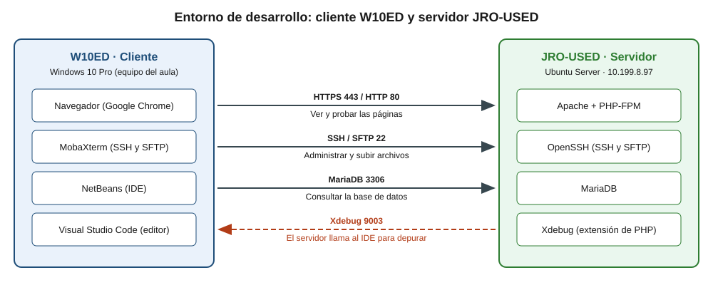

---

## Ficha del entorno

Todos los valores que se usan en la guía, reunidos en un solo sitio:

| Dato | Valor |
|---|---|
| Equipo cliente | `W10ED` – Windows 10 Pro 22H2 (64 bits) |
| Servidor de desarrollo | `JRO-USED` – IP `10.199.8.97` en clase (`192.168.1.100` en casa) |
| Administración del servidor (SSH) | `miadmin` / `paso` |
| Subida de archivos (SFTP) | `operadorweb` / `paso` – directorio inicial `/var/www/html` |
| Base de datos (MariaDB) | `adminsql` / `paso` – puerto `3306` |
| Depuración (Xdebug) | Puerto `9003` (el servidor se conecta al cliente) |
| Proyectos de NetBeans | `D:\PROYECTOS-NETBEANS` |
| Proyectos de Visual Studio Code | `D:\PROYECTOS-VISUAL-STUDIO` |
| Proyecto de ejemplo | `JRODWESProyectoTema4` |
| Ruta del proyecto en el servidor | `/var/www/html/JRODWESProyectoTema4` |
| Dirección web del proyecto | `https://10.199.8.97/JRODWESProyectoTema4/` |

> **Aviso de seguridad.** Las contraseñas (`paso`) y el guardado de contraseñas en los programas son cómodos en un entorno de aprendizaje, pero no deben usarse en un servidor real. Los archivos que contienen contraseñas (como `sftp.json`) **nunca** deben subirse a GitHub.

> **Sobre las capturas de pantalla.** Las imágenes son ilustrativas: algunas se tomaron en otro equipo o en otra red, por lo que pueden mostrar otra IP (`10.199.9.184`, `192.168.1.100`) u otros nombres de proyecto. **Los valores que hay que escribir son siempre los de las tablas de esta guía.**

---

## Índice

- [1. Configuración de la máquina](#1-configuración-de-la-máquina)
- [2. Cuentas administradoras y cuenta de desarrollador](#2-cuentas-administradoras-y-cuenta-de-desarrollador)
- [3. Navegadores](#3-navegadores)
- [4. Software: MobaXterm](#4-software-mobaxterm)
  - [4.1. Instalación de MobaXterm](#41-instalación-de-mobaxterm)
  - [4.2. Configuración de MobaXterm](#42-configuración-de-mobaxterm)
  - [4.3. Ejemplo de uso de MobaXterm](#43-ejemplo-de-uso-de-mobaxterm)
- [5. Software: NetBeans](#5-software-netbeans)
  - [5.1. Instalación de NetBeans y plugins](#51-instalación-de-netbeans-y-plugins)
  - [5.2. Configuración de NetBeans](#52-configuración-de-netbeans)
  - [5.3. Ejemplo de uso de NetBeans](#53-ejemplo-de-uso-de-netbeans)
- [6. Software: Visual Studio Code](#6-software-visual-studio-code)
  - [6.1. Instalación de Visual Studio Code](#61-instalación-de-visual-studio-code)
  - [6.2. Configuración de Visual Studio Code: el workspace](#62-configuración-de-visual-studio-code-el-workspace)
  - [6.3. Extensión SFTP](#63-extensión-sftp)
  - [6.4. Extensiones de PHP: IntelliSense y PHP Debug](#64-extensiones-de-php-intellisense-y-php-debug)
  - [6.5. Extensión SQLTools](#65-extensión-sqltools)
  - [6.6. Control de versiones con Git](#66-control-de-versiones-con-git)
  - [6.7. Extensiones opcionales](#67-extensiones-opcionales)
- [7. Resumen y solución de problemas](#7-resumen-y-solución-de-problemas)
- [Créditos](#créditos)

---

## 1. Configuración de la máquina

El equipo cliente es el ordenador del aula desde el que se escribe el código. No ejecuta las aplicaciones web: las edita y las envía al servidor, que es quien las ejecuta.

El sistema operativo utilizado es Windows 10 Pro.

**Especificaciones de Windows:**

| Dato | Valor |
|---|---|
| Edición | Windows 10 Pro |
| Versión | 22H2 |
| Instalado el | 08/09/2025 |
| Experiencia | Windows Feature Experience Pack 1000.19062.1000.0 |

**Especificaciones del dispositivo (supervisado por un dominio):**

| Dato | Valor |
|---|---|
| Nombre del dispositivo | ED49000391P391 |
| Nombre completo del dispositivo | ED49000391P391.educa.jcyl.es |
| Procesador | Intel(R) Core(TM) i5-7400 CPU @ 3.00GHz 3.00 GHz |
| RAM instalada | 16,0 GB (15,9 GB usable) |
| Tipo de sistema | Sistema operativo de 64 bits, procesador basado en x64 |

**Cómo consultar estos datos:** `Configuración > Sistema > Acerca de`, o pulsando `Win + Pausa`.

> **Datos útiles.**
> - 22H2 es la última versión de Windows 10. Su soporte general terminó el 14 de octubre de 2025; desde entonces solo recibe parches de seguridad mediante el programa de actualizaciones extendidas (ESU).
> - "Supervisado por un dominio" significa que el equipo lo administra de forma centralizada la Junta de Castilla y León: el usuario no es administrador local, así que algunas instalaciones o cambios en el cortafuegos pueden requerir al responsable del aula. Por eso en esta guía se indican, cuando existen, las versiones **portables** o **de usuario**, que no necesitan permisos de administrador.
> - Los proyectos se guardan en el disco de datos (`D:`) y no en `C:`, para separarlos del sistema.

**Comprobar que el cliente ve al servidor.** Abre `cmd` o PowerShell y ejecuta:

```powershell
ping 10.199.8.97
```

Si responde, hay conexión de red y se puede continuar. *(En casa, la IP del servidor es `192.168.1.100`; sustitúyela en todos los ejemplos de la guía.)*

---

## 2. Cuentas administradoras y cuenta de desarrollador

**En el equipo cliente (Windows):**

- **Cuentas administradoras:** el dominio está gestionado por la Junta de Castilla y León (`educa.jcyl`).
- **Cuenta de desarrollador:** se utiliza la cuenta personal del portal (`juan.rivord@educa.jcyl.es`).

**En el servidor (las que se usan desde este cliente):**

| Cuenta | Contraseña | Para qué se usa | Desde qué programa |
|---|---|---|---|
| `miadmin` | `paso` | Administrar el servidor por terminal (SSH) | MobaXterm |
| `operadorweb` | `paso` | Subir y modificar el contenido web (SFTP) | MobaXterm, NetBeans, VS Code |
| `adminsql` | `paso` | Administrar las bases de datos MariaDB | NetBeans, SQLTools, phpMyAdmin |

> **¿Por qué tres cuentas distintas?** Por el *principio de mínimo privilegio*: cada tarea se hace con la cuenta que tiene solo los permisos necesarios. Para subir páginas se usa `operadorweb`, que solo puede tocar `/var/www/html`, y no `miadmin`, que puede administrar todo el servidor.

---

## 3. Navegadores

- El navegador principal utilizado es **Google Chrome**.
- Es recomendable tener un segundo navegador (por ejemplo, **Firefox**) para comprobar que las páginas se ven igual en motores distintos: Chrome y Edge usan Blink; Firefox usa Gecko.

**Aviso del certificado.** El servidor usa HTTPS con un certificado autofirmado, así que la primera vez Chrome muestra *"La conexión no es privada"*. En un entorno de desarrollo es lo esperado: pulsa **Configuración avanzada > Acceder a 10.199.8.97 (sitio no seguro)**.

**Herramientas útiles para desarrollar:**

| Acción | Atajo en Chrome |
|---|---|
| Abrir las herramientas de desarrollador (DevTools) | `F12` |
| Recargar ignorando la caché | `Ctrl + F5` |
| Ver el código fuente de la página | `Ctrl + U` |
| Ventana de incógnito (sin caché ni sesiones guardadas) | `Ctrl + Shift + N` |

> **Consejo.** Si cambias un archivo CSS o JavaScript y "no se ve el cambio", casi siempre es la caché del navegador: recarga con `Ctrl + F5`. Con DevTools abierto puedes marcar **Network > Disable cache** para evitarlo mientras desarrollas.

---

## 4. Software: MobaXterm

**MobaXterm** es un terminal para Windows que reúne en un solo programa el cliente **SSH** (manejar el servidor escribiendo órdenes) y el cliente **SFTP** (transferir archivos con el ratón). Guarda las sesiones para conectarse con un doble clic.

### 4.1. Instalación de MobaXterm

1. Descarga MobaXterm **Home Edition** (gratuita) desde: <https://mobaxterm.mobatek.net/download.html>
2. Elige una de las dos versiones:
   - **Installer edition:** se instala como cualquier programa (requiere permisos de administrador).
   - **Portable edition:** un archivo `.zip` que se descomprime y se ejecuta directamente. **Es la opción adecuada en los equipos del dominio**, porque no necesita permisos de administrador.
3. Ejecuta `MobaXterm.exe`. Si Windows pregunta por el cortafuegos, permite el acceso.

> **Dato útil.** La edición gratuita permite guardar hasta 12 sesiones, más que suficiente para este entorno.

---

### 4.2. Configuración de MobaXterm

Se crean dos sesiones guardadas: una para administrar (SSH) y otra para transferir archivos (SFTP).

#### 4.2.1. Crear una sesión SSH

1. Abre MobaXterm y haz clic en el botón **"Session"** (esquina superior izquierda).
2. Selecciona el tipo de sesión **"SSH"**.
3. En el campo **"Remote host"**, introduce la dirección IP del servidor: `10.199.8.97`.
4. Marca la casilla **"Specify username"** e introduce el usuario administrador: `miadmin`.
5. Comprueba que el puerto es el `22` y haz clic en **"OK"**.
6. Al abrirse la terminal, introduce la contraseña (`paso`). Al escribirla no se ve nada en pantalla: es normal.

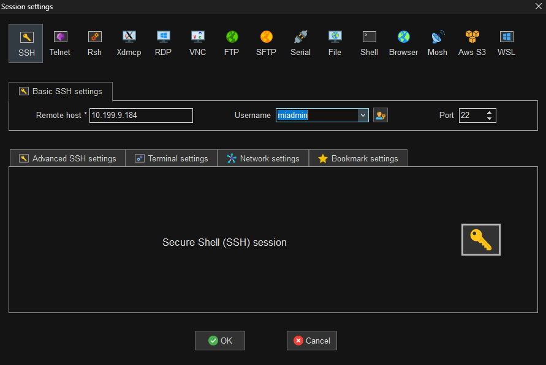

> La primera vez, MobaXterm pregunta si confías en la identidad del servidor: acepta. También ofrece guardar la contraseña; en el equipo del aula, compartido, es más prudente no guardarla.

#### 4.2.2. Crear una sesión SFTP

1. Haz clic nuevamente en **"Session"** y selecciona la pestaña **"SFTP"**.
2. En el campo **"Remote host"**, introduce la IP del servidor: `10.199.8.97`.
3. En el campo **"Username"**, introduce el usuario con permisos web: `operadorweb`.
4. Haz clic en **"OK"** e introduce la contraseña (`paso`) cuando el programa la solicite.
5. Se abre una interfaz gráfica con tus carpetas locales a la izquierda y las del servidor a la derecha (directorio inicial `/var/www/html`).

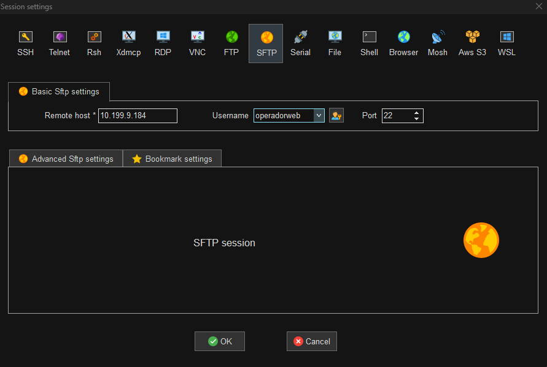

Las dos sesiones quedan guardadas en la pestaña lateral **Sessions**; a partir de ahora basta un doble clic para conectarse.

---

### 4.3. Ejemplo de uso de MobaXterm

**1. Administrar el servidor por SSH.** Abre la sesión de `miadmin` y comprueba el estado de los servicios:

```bash
hostnamectl
sudo systemctl status apache2
sudo systemctl status php8.5-fpm
sudo systemctl status mariadb
```

*(Se sale de cada pantalla de estado pulsando `q`.)*

**2. Crear la carpeta del proyecto en el servidor.** Abre una sesión SSH con el usuario `operadorweb` (igual que la anterior, cambiando el usuario) y ejecuta:

```bash
mkdir /var/www/html/JRODWESProyectoTema4
ls -l /var/www/html
```

Al crearla con `operadorweb`, la carpeta ya nace con el propietario y el grupo correctos (`operadorweb:www-data`).

**3. Transferir archivos por SFTP.** Abre la sesión SFTP: arrastra un archivo del panel izquierdo (tu equipo) al derecho (servidor) para subirlo, o al revés para descargarlo. Con clic derecho sobre un archivo remoto puedes renombrarlo, borrarlo o cambiar sus permisos.

> **Truco.** Al abrir una sesión **SSH**, MobaXterm muestra también a la izquierda un explorador SFTP de la misma conexión; marcando **"Follow terminal folder"** el explorador sigue a la carpeta en la que estés en la terminal.

**4. Probar la jaula SFTP.** Crea otra sesión SFTP con el usuario `enjaulado1` (contraseña `paso`): solo debe verse la carpeta `httpdocs`, sin posibilidad de subir al resto del servidor.

---

## 5. Software: NetBeans

**Apache NetBeans** es un IDE (*Integrated Development Environment*, entorno de desarrollo integrado): un programa que reúne el editor de código, la subida de archivos al servidor, el cliente de base de datos, el control de versiones y el depurador. Nació en 1996 como proyecto de unos estudiantes de Praga y hoy lo mantiene la Apache Software Foundation.

### 5.1. Instalación de NetBeans y plugins

**Requisito previo: Java.** NetBeans está escrito en Java y necesita un **JDK** instalado. Descarga una versión LTS (por ejemplo, desde <https://adoptium.net/>) e instálala antes que NetBeans; la página de descarga de NetBeans indica la versión mínima que necesita.

**Instalación:**

1. El sitio web oficial de descarga es <https://netbeans.apache.org/front/main/index.html>.
2. Descarga el instalador para Windows y ejecútalo.
3. Acepta los términos de la licencia. Si el asistente permite elegir tecnologías (Java SE, Java EE, PHP, etc.), selecciona las que vayas a usar; en las versiones actuales se activan después, desde el propio programa.
4. Ejecuta Apache NetBeans por primera vez; puede tardar unos segundos mientras carga los módulos internos.

**Plugins.** Un *plugin* es un módulo que añade a NetBeans el soporte para un lenguaje o una herramienta.

1. Accede a **Tools > Plugins**.
2. En la pestaña **Installed**, marca **PHP** y **HTML5** y pulsa **Activate**. *(Si no aparecen ahí, búscalos en la pestaña **Available Plugins** y pulsa **Install**.)*
3. Reinicia NetBeans si lo solicita.

En esta configuración se activaron los módulos de **HTML5** y **PHP**.

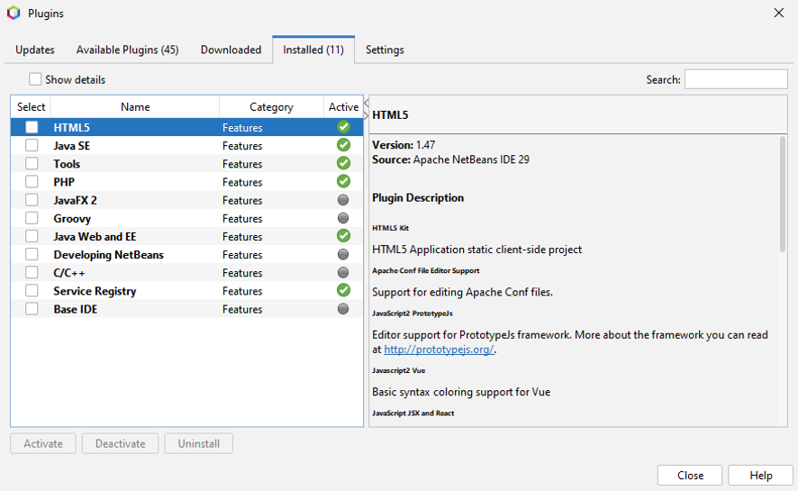

En la captura, la columna **Active** muestra una marca verde en los módulos activos (HTML5, PHP…) y un círculo gris en los inactivos. El panel derecho indica la versión de NetBeans de la que procede cada módulo.

---

### 5.2. Configuración de NetBeans

#### 5.2.1. Proyecto PHP conectado al servidor

Los proyectos se guardan en el disco de datos, en la carpeta `D:\PROYECTOS-NETBEANS`, con una subcarpeta por proyecto:

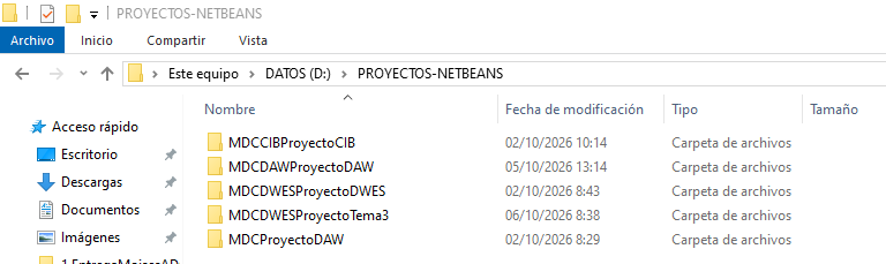

1. Haz clic en **File > New Project**, elige la categoría **PHP** y el tipo **"PHP Application"**.

   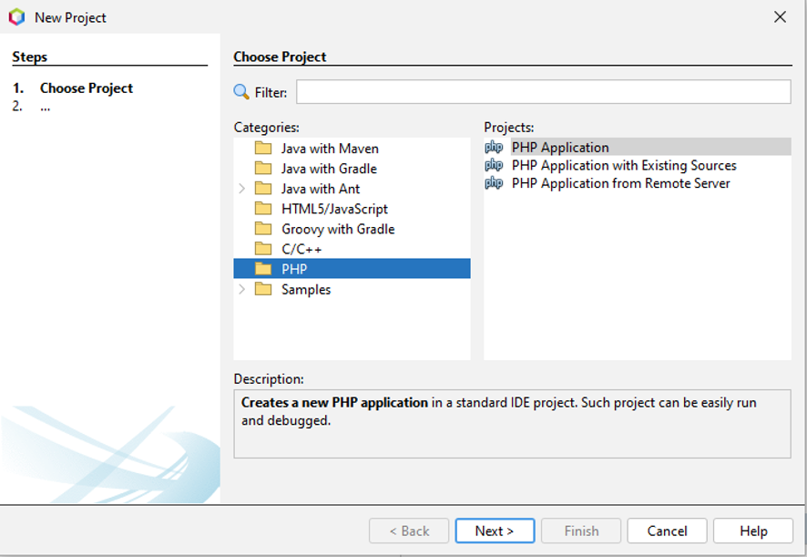

   > Los otros dos tipos sirven para casos distintos: *with Existing Sources* crea el proyecto sobre una carpeta que ya tiene código, y *from Remote Server* descarga primero el código que ya está en el servidor.

2. Asígnale un nombre (`JRODWESProyectoTema4`) e indica el directorio local (`D:\PROYECTOS-NETBEANS\JRODWESProyectoTema4`).
3. **Versión de PHP:** selecciona la más alta que ofrezca NetBeans (idealmente la del servidor, PHP 8.5). **Codificación:** UTF-8.

   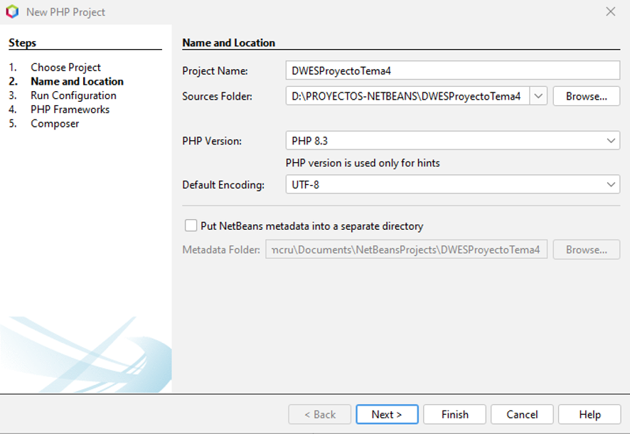

   > Como indica el propio asistente (*"PHP version is used only for hints"*), esta versión solo afecta a las ayudas y avisos del editor: el código lo ejecuta el PHP del servidor, no NetBeans.

4. **Configuración remota.** En la configuración de ejecución (*Run Configuration*), en **Run As** elige **"Remote Web Site (FTP, SFTP)"** y rellena:

   | Campo | Valor |
   |---|---|
   | Project URL | `https://10.199.8.97/JRODWESProyectoTema4/` |
   | Remote Connection | Pulsa **Manage…** y crea una conexión nueva de tipo **SFTP** (tabla siguiente) |
   | Upload Directory | `/JRODWESProyectoTema4` |
   | Upload Files | **On Save** |

   Datos de la conexión SFTP (**Manage… > Add…**):

   | Campo | Valor |
   |---|---|
   | Connection Name | `JRO-USED` |
   | Host Name | `10.199.8.97` |
   | Port | `22` |
   | User Name | `operadorweb` |
   | Password | `paso` |
   | Initial Directory | `/var/www/html` |

   Pulsa **Test Connection** para comprobarla antes de aceptar.

   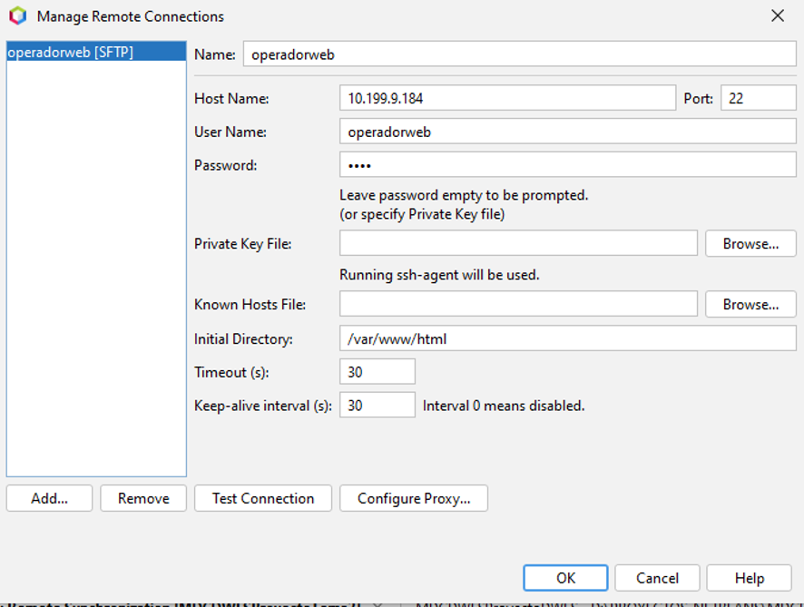

   El paso *Run Configuration* completo queda así:

   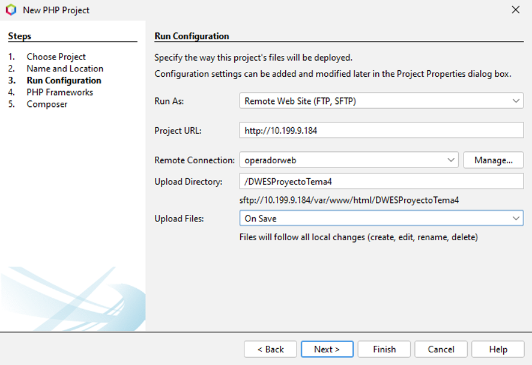

5. **Subida automática.** Con **Upload Files: On Save**, cada vez que crees o modifiques un archivo y pulses Guardar (`Ctrl + S`), NetBeans se conecta por SFTP y actualiza el archivo en el servidor, sin subirlo a mano. Como dice el asistente, los archivos del servidor siguen todos los cambios locales: crear, editar, renombrar y borrar.

   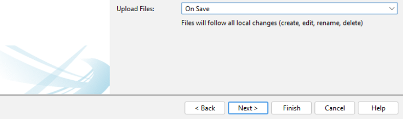

> **Cómo se forma la ruta remota.** *Initial Directory* + *Upload Directory* = `/var/www/html` + `/JRODWESProyectoTema4`. NetBeans muestra el resultado justo debajo del campo *Upload Directory*, en la línea que empieza por `sftp://`: es la forma más rápida de comprobar que los archivos irán al sitio correcto.
>
> 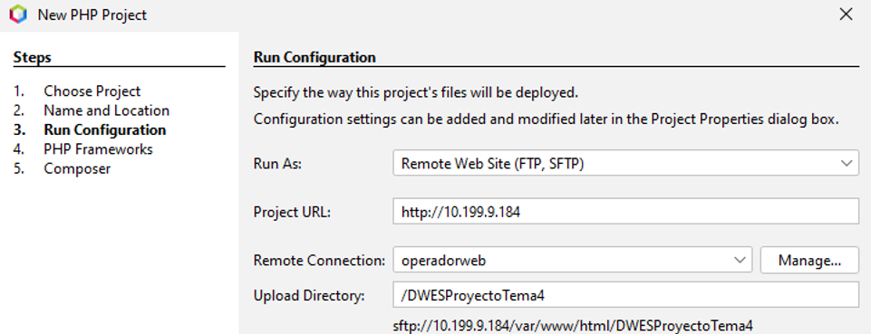
>
> **Sobre `http` y `https`.** El servidor redirige automáticamente `http://` a `https://`, así que ambas direcciones funcionan; se escribe `https://` directamente para evitar el salto.

Estos valores se pueden cambiar en cualquier momento con clic derecho sobre el proyecto > **Properties > Run Configuration**.

#### 5.2.2. Conexión con la base de datos

NetBeans permite administrar de forma remota bases de datos MySQL/MariaDB directamente desde el IDE: ejecutar scripts SQL y ver tablas sin cambiar a phpMyAdmin ni a la consola.

1. Ve a la pestaña **Services** (Servicios), en el panel lateral izquierdo junto a *Projects*. *(Si no está visible: **Window > Services** o `Ctrl + 5`.)*
2. Despliega el nodo **Databases** (Bases de datos).
3. Haz clic derecho sobre **Databases** y selecciona **New Connection…**

   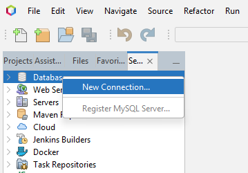

4. En el desplegable **Driver**, selecciona **MariaDB (MySQL-compatible)**. NetBeans no trae el archivo del driver, así que hay que añadirlo:
   - Descarga **MariaDB Connector/J** (un archivo `mariadb-java-client-X.Y.Z.jar`) desde <https://mariadb.com/downloads/connectors/> y guárdalo en una carpeta que no vayas a borrar.
   - Pulsa **Add…**, selecciona ese archivo `.jar` y haz clic en *Next*.

   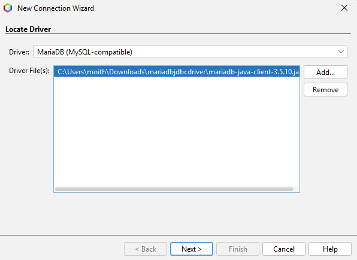

5. Rellena los datos del servidor:

   | Campo | Valor |
   |---|---|
   | Host | `10.199.8.97` |
   | Port | `3306` (el puerto por defecto de MariaDB) |
   | Database | `mysql` (la base de datos interna, que existe siempre) o el nombre de una base de datos ya creada |
   | User Name | `adminsql` |
   | Password | `paso` (marca "Remember password" si no quieres escribirla cada vez) |
   | JDBC URL | Se rellena sola: `jdbc:mariadb://10.199.8.97:3306/mysql` |

   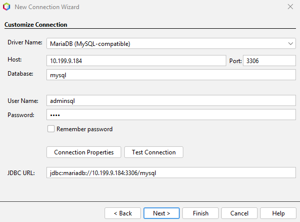

6. Haz clic en **Test Connection**. Si la configuración del servidor es correcta (`bind-address = 0.0.0.0` y el puerto 3306 abierto en UFW), aparece el mensaje *Connection Succeeded*.
7. Haz clic en **Next** y en **Finish**. La conexión aparece bajo **Databases**; con clic derecho > **Rename…** se le puede poner un nombre descriptivo (por ejemplo, `Conexion a MariaDB desde Netbeans`).

> **¿Qué es un driver JDBC?** Es la "pieza traductora" que permite a un programa Java, como NetBeans, hablar con un gestor de bases de datos concreto. La **URL JDBC** resume toda la conexión en una línea: `jdbc:mariadb://` (el driver) + `10.199.8.97:3306` (servidor y puerto) + `/mysql` (base de datos).

#### 5.2.3. Conexión con el repositorio (Git)

NetBeans incorpora soporte nativo para Git, sin instalar nada más. Lo único que hay que preparar es la autenticación con GitHub.

**Token de acceso personal.** Desde agosto de 2021 GitHub no admite la contraseña de la cuenta para operaciones Git: hay que usar un *token*.

1. En GitHub: **Settings > Developer settings > Personal access tokens**.
2. Genera un token con permiso sobre los repositorios (`repo`) y una fecha de caducidad.
3. Cópialo en ese momento: GitHub no vuelve a mostrarlo.

En NetBeans, cuando se pida **User** se escribe el nombre de usuario de GitHub y en **Password** se pega el token.

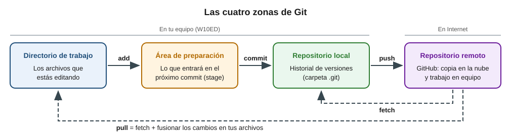

**Escenario A: inicializar un proyecto local y subirlo a GitHub.** *Cuando has creado el proyecto desde cero en NetBeans y quieres subirlo por primera vez a un repositorio vacío.*

1. **Inicializar:** clic derecho sobre el proyecto en *Projects* > **Versioning > Initialize Git Repository…** y confirma la ruta. Los archivos se muestran en verde (nuevos, todavía sin registrar).
2. **Primer commit:** clic derecho en el proyecto > **Git > Commit…** Escribe un mensaje (por ejemplo, "Commit inicial") y pulsa *Commit*.
3. **Vincular y subir (push):** clic derecho en el proyecto > **Git > Remote > Push…**
   - Marca "Specify Git Repository Location".
   - Introduce la URL del repositorio vacío de GitHub, tu usuario y el token en el campo de contraseña.
   - Selecciona la rama local (normalmente `main` o `master`) y finaliza el asistente.

**Escenario B: clonar un repositorio existente desde GitHub.** *Cuando el proyecto ya existe en GitHub y quieres descargarlo a tu equipo.*

1. En el menú superior, ve a **Team > Git > Clone…**
2. Introduce la URL del repositorio remoto (por ejemplo, `https://github.com/usuario/repositorio.git`).
3. Rellena tu usuario y tu token (en "Password").
4. Selecciona la rama que quieres clonar y la carpeta local de destino (`D:\PROYECTOS-NETBEANS`).
5. NetBeans pregunta si quieres abrir el proyecto recién clonado: responde que sí.

> **Buena práctica.** Crea en la raíz del proyecto un archivo `.gitignore` que contenga la línea `nbproject/private/`: esa carpeta guarda ajustes personales (incluida la configuración de la conexión remota) que no deben subirse al repositorio.

#### 5.2.4. Depuración (configuración de la ejecución para la depuración)

Depurar es ejecutar el programa paso a paso para ver qué hace realmente. Se apoya en **Xdebug**, ya instalado en el servidor. Lo peculiar es el sentido de la conexión: es el **servidor** el que llama al **IDE**.

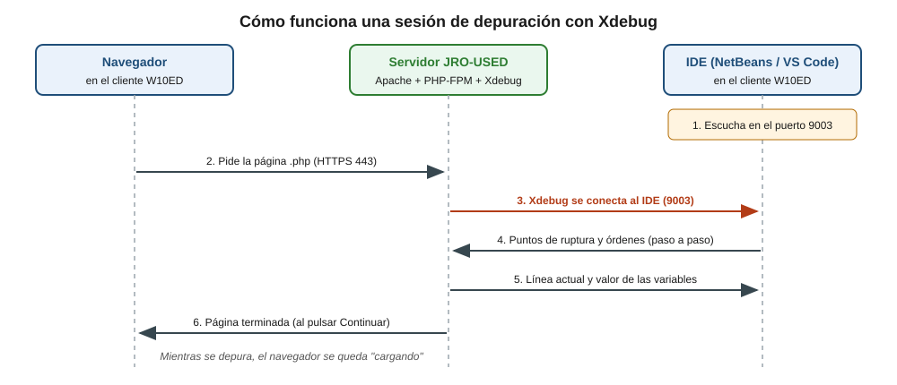

**1. Opciones generales del depurador.** En **Tools > Options > PHP > Debugging**:

| Campo | Valor | Para qué |
|---|---|---|
| Debugger Port | `9003` | Debe coincidir con `xdebug.client_port` del servidor |
| Session ID | `netbeans-xdebug` | Identificador de la sesión (valor por defecto) |
| Stop at First Line | Desmarcado | Si se marca, se detiene siempre en la primera línea aunque no haya puntos de ruptura |

**2. Correspondencia de rutas del proyecto.** Clic derecho en el proyecto > **Properties > Run Configuration > Advanced…** y, en **Path Mapping**, añade:

| Server Path | Project Path |
|---|---|
| `/var/www/html/JRODWESProyectoTema4` | `D:\PROYECTOS-NETBEANS\JRODWESProyectoTema4` |

Esta tabla le dice a NetBeans que el archivo que el servidor está ejecutando corresponde a ese archivo de tu disco. Sin ella, el depurador conecta pero no se detiene en los puntos de ruptura.

**3. Cortafuegos de Windows.** La primera vez que NetBeans se pone a escuchar, Windows pregunta si se permite el acceso a la red: hay que **permitirlo**. Si el aviso no aparece o no tienes permisos para aceptarlo, hay que solicitar al responsable del aula que abra el puerto `9003` de entrada.

> **Lado del servidor.** No hay que tocar nada: en la guía de USED se configuró `xdebug.start_with_request = yes` y `xdebug.discover_client_host = yes`, de modo que el servidor intenta conectarse al equipo que pide la página, sea cual sea.

---

### 5.3. Ejemplo de uso de NetBeans

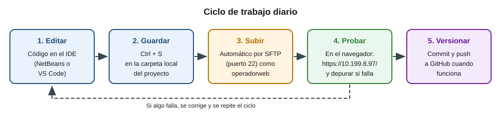

#### 5.3.1. Creación, modificación, borrado y prueba

- **Creación.** Clic derecho en *Source Files* > **New > PHP File…**, nómbralo `index` y escribe:

  ```php
  <?php
  /**
   * Página de prueba del proyecto.
   *
   * @author Juan Rivera Ordóñez
   */
  $hoy = date('d/m/Y H:i');
  echo "<h1>JRODWESProyectoTema4</h1>";
  echo "<p>Servidor: " . gethostname() . " – $hoy</p>";
  ```

- **Modificación.** Al pulsar `Ctrl + S`, NetBeans sube el archivo al servidor (se ve el progreso en la ventana *Output*). No hace falta subir nada a mano.

- **Prueba (testing).** Clic derecho sobre el proyecto > **Run**, o el icono de reproducción (Play) de la barra superior, o `F6`. NetBeans abre el navegador predeterminado con la dirección del proyecto: `https://10.199.8.97/JRODWESProyectoTema4/`. *(El navegador se elige en **Tools > Options > General > Web Browser**.)*

  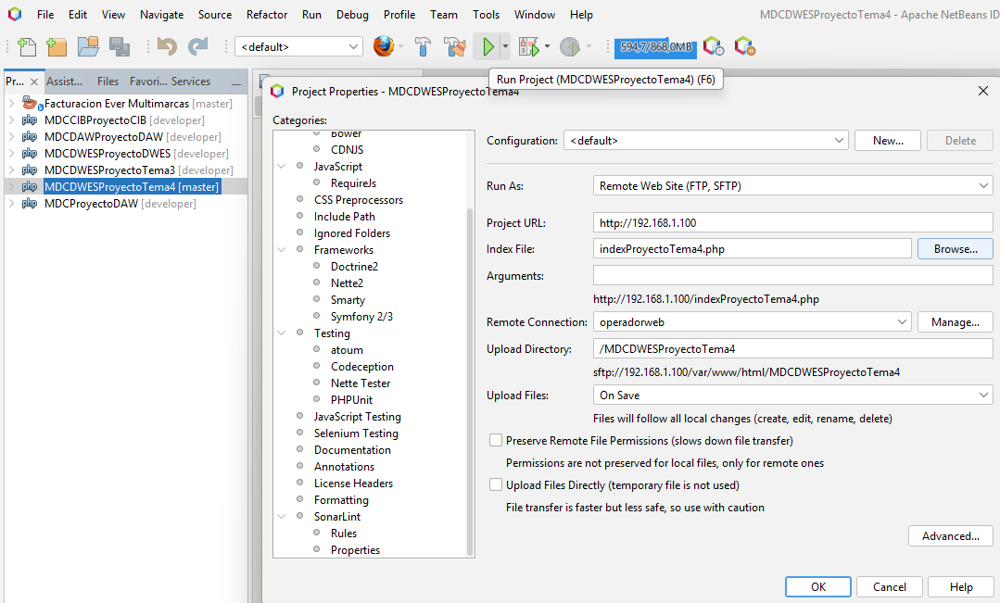

  En la captura se ve, detrás del botón **Run Project**, la ventana *Project Properties > Run Configuration*. Su campo **Index File** indica qué archivo se abre al ejecutar el proyecto (por ejemplo, `indexProyectoTema4.php`); si se deja vacío, el servidor muestra el `index` de la carpeta.

  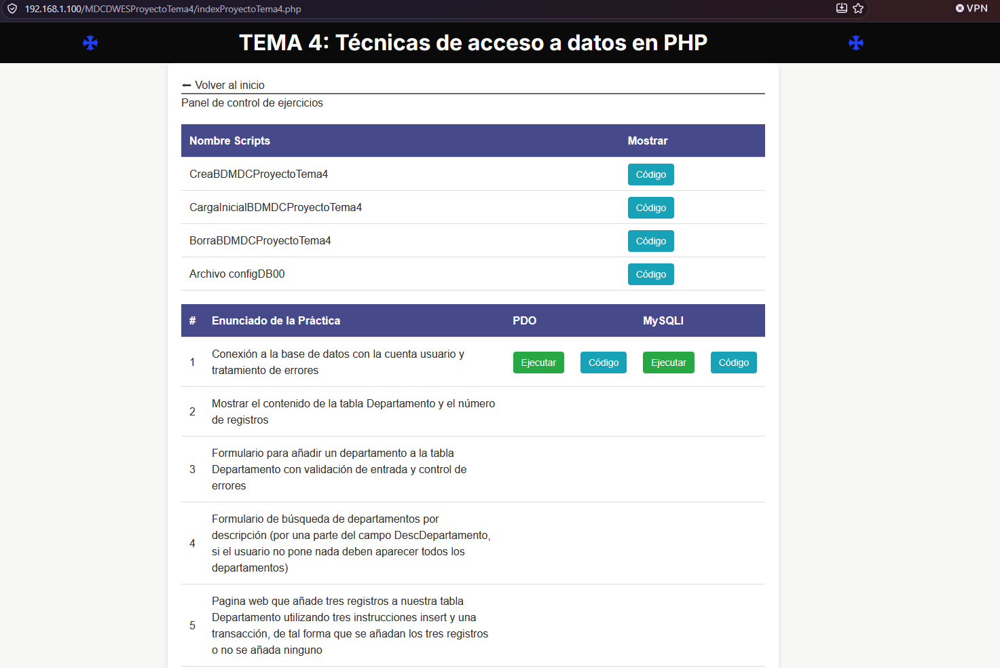

- **Borrado.** Clic derecho sobre el archivo o el proyecto en *Projects* > **Delete**.
  - Al borrar un **archivo**, NetBeans pregunta si también debe eliminarse del servidor.
  - Al borrar un **proyecto completo**, pregunta si se elimina solo la configuración del IDE o también las fuentes locales (*Also delete sources*). La carpeta del servidor **no** se borra: hay que eliminarla por SFTP (por ejemplo, con MobaXterm).

  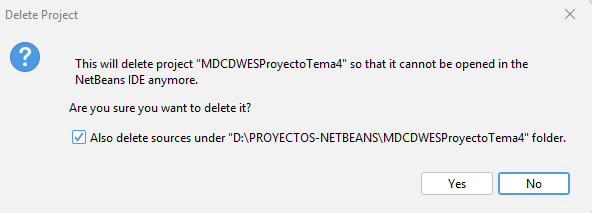

- **Subida y descarga manual.** Clic derecho sobre el proyecto o una carpeta > **Upload…** / **Download…** / **Synchronize…** Es útil para imágenes o archivos copiados desde fuera del IDE, que no pasan por "guardar".

#### 5.3.2. Administración de la base de datos

1. En **Services > Databases**, clic derecho sobre la conexión > **Connect**.
2. Clic derecho sobre la conexión > **Execute Command…** Se abre el editor SQL.
3. Escribe una consulta y ejecútala con `Ctrl + Shift + E`:

   ```sql
   SHOW DATABASES;
   SELECT User, Host FROM mysql.user;
   ```

4. Desplegando la conexión se ven las bases de datos y sus tablas; con clic derecho sobre una tabla > **View Data…** se muestran sus registros, que se pueden insertar, editar o borrar desde la propia rejilla.

**Ejecutar un script `.sql` del proyecto.** Es lo habitual con los scripts de creación, carga inicial y borrado de la base de datos de cada tema:

1. Abre el archivo `.sql` desde la pestaña *Projects*.
2. Pulsa **Run File** (`Shift + F6`) o el botón *Run SQL* de la barra del editor.
3. Si el archivo aún no tiene conexión asignada, NetBeans muestra la ventana **Select Database Connection**: elige la conexión creada en el apartado 5.2.2 y pulsa **OK**. También se puede elegir en el desplegable **Connection** de la parte superior del editor.

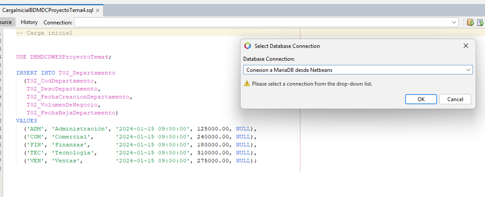

> **Buena práctica.** Guarda los scripts SQL dentro del proyecto (por ejemplo, en una carpeta `scriptDB/`): así quedan versionados con Git y cualquiera puede reconstruir la base de datos desde cero.

#### 5.3.3. Versionado en el día a día

Con el repositorio conectado, estas son las opciones disponibles con clic derecho sobre el proyecto > **Git**:

| Opción | Qué hace |
|---|---|
| **Commit** | Guarda los cambios de forma local en tu equipo. Escribe siempre un mensaje descriptivo |
| **Remote > Fetch** | Descarga el historial más reciente del repositorio remoto, pero *no* lo fusiona con tu código. Útil para revisar qué han subido tus compañeros antes de integrarlo |
| **Remote > Pull** | Descarga y fusiona directamente las actualizaciones del remoto con tu código local |
| **Remote > Push** | Envía tus *commits* locales a GitHub, donde quedan respaldados |
| **Branch > Create Branch…** | Crea una línea de trabajo paralela, para desarrollar una funcionalidad sin romper el código principal |
| **Branch > Checkout…** | Cambia de una rama a otra |
| **Branch > Merge Revision…** | Combina los cambios de otra rama en la rama en la que estás trabajando |
| **Resolve Conflicts** | Si al hacer Pull o Merge hay líneas contradictorias, abre una herramienta visual (Diff) para decidir qué cambios mantener |
| **Show History** | Muestra la línea de tiempo con todos los commits, fechas y autores |

**Colores de los archivos en NetBeans:** verde = nuevo, azul = modificado, rojo = en conflicto, gris = ignorado.

**Pull Requests (PR).** Se revisan y aprueban en la web de GitHub, pero el flujo empieza en NetBeans: creas una rama, haces tus cambios, haces *Push* de esa rama y, desde el navegador, abres el PR para solicitar que tu código se integre en `main` / `master`.

> **Buena práctica.** Haz *Pull* antes de empezar a trabajar y antes de cada *Push*; commits pequeños y frecuentes, con mensajes que digan *qué* cambia ("Añade validación del formulario de login") y no "cambios".

#### 5.3.4. Depurar un programa

1. Abre un archivo PHP y haz clic sobre el número de una línea para poner un **punto de ruptura** (*breakpoint*): la línea queda marcada en rojo. También con `Ctrl + F8`.
2. Pulsa **Debug Project** (`Ctrl + F5`). NetBeans se pone a escuchar y abre el navegador.
3. La ejecución se detiene en la línea marcada, que se resalta en verde. En la parte inferior, la ventana **Variables** muestra el valor de cada variable en ese instante.
4. Avanza con estas teclas:

   | Tecla | Acción |
   |---|---|
   | `F8` | *Step Over*: ejecuta la línea y pasa a la siguiente |
   | `F7` | *Step Into*: entra dentro de la función que se llama en esa línea |
   | `Ctrl + F7` | *Step Out*: termina la función actual y vuelve a quien la llamó |
   | `F5` | *Continue*: sigue hasta el siguiente punto de ruptura |
   | `Shift + F5` | Termina la sesión de depuración |

5. Al continuar hasta el final, el navegador muestra la página terminada.

> 📷 *Captura recomendada:* NetBeans detenido en un punto de ruptura, con la ventana **Variables** visible.

#### 5.3.5. Documentar el código con PHPDoc

**PHPDoc** es el estándar para documentar código PHP mediante comentarios especiales que empiezan por `/**`. NetBeans los usa para mostrar ayuda al autocompletar y sirven para generar la documentación del proyecto.

Escribe `/**` justo encima de una función y pulsa `Enter`: NetBeans genera la plantilla con los parámetros.

```php
/**
 * Calcula el precio final de un producto aplicando el IVA.
 *
 * @param float $precio Precio sin impuestos.
 * @param float $iva    Porcentaje de IVA (por defecto, 21).
 * @return float Precio con el IVA incluido.
 */
function calcularPrecioFinal(float $precio, float $iva = 21): float
{
    return $precio * (1 + $iva / 100);
}
```

| Etiqueta | Significado |
|---|---|
| `@param` | Tipo, nombre y descripción de cada parámetro |
| `@return` | Tipo y descripción del valor devuelto |
| `@author` | Autor del archivo o de la función |
| `@since` | Fecha o versión desde la que existe |
| `@throws` | Excepciones que puede lanzar |

Con estos comentarios, la herramienta **phpDocumentor** (<https://phpdoc.org/>) genera un sitio web con la documentación completa del proyecto.

---

## 6. Software: Visual Studio Code

**Visual Studio Code** (VS Code) es un editor de código gratuito de Microsoft. A diferencia de NetBeans, recién instalado es muy ligero y casi no trae nada: cada función (subir archivos, depurar PHP, consultar bases de datos) se añade con una **extensión**. Por eso, en este capítulo, cada extensión se documenta con su instalación, su configuración y su ejemplo de uso.

### 6.1. Instalación de Visual Studio Code

1. Accede al sitio web oficial, <https://code.visualstudio.com/>, y descarga el instalador para Windows.
2. Ejecuta el archivo descargado.
3. Acepta los términos de la licencia y deja la ruta de instalación por defecto.
4. En la pantalla de tareas adicionales, es **muy recomendable marcar**:
   - *Añadir la acción "Abrir con Code" al menú contextual de archivos.*
   - *Añadir la acción "Abrir con Code" al menú contextual de directorios.*
   - *Agregar a PATH (requiere reiniciar).*
5. Haz clic en Instalar y, al finalizar, ejecuta la aplicación.

> **Dato útil.** El instalador *User Installer* (el que se descarga por defecto) se instala solo para tu usuario y **no necesita permisos de administrador**, lo que lo hace adecuado para los equipos del dominio.

**Cómo se instala cualquier extensión.** Abre la pestaña **Extensions** (icono de cuadros en el menú lateral izquierdo, o `Ctrl + Shift + X`), escribe el nombre en el buscador y pulsa **Install**.

**Extensiones obligatorias:**

| Extensión | Para qué sirve | Apartado |
|---|---|---|
| **SFTP** | Subir y bajar archivos al servidor automáticamente | [6.3](#63-extensión-sftp) |
| **PHP IntelliSense** (incluida en *PHP Extension Pack*) | Autocompletado avanzado y ayuda al escribir PHP | [6.4](#64-extensiones-de-php-intellisense-y-php-debug) |
| **PHP Debug** (incluida en *PHP Extension Pack*) | Depurar con Xdebug | [6.4](#64-extensiones-de-php-intellisense-y-php-debug) |
| **SQLTools** | Administrar bases de datos | [6.5](#65-extensión-sqltools) |
| **SQLTools MySQL/MariaDB/TiDB** | Driver para conectar SQLTools con el servidor Ubuntu | [6.5](#65-extensión-sqltools) |

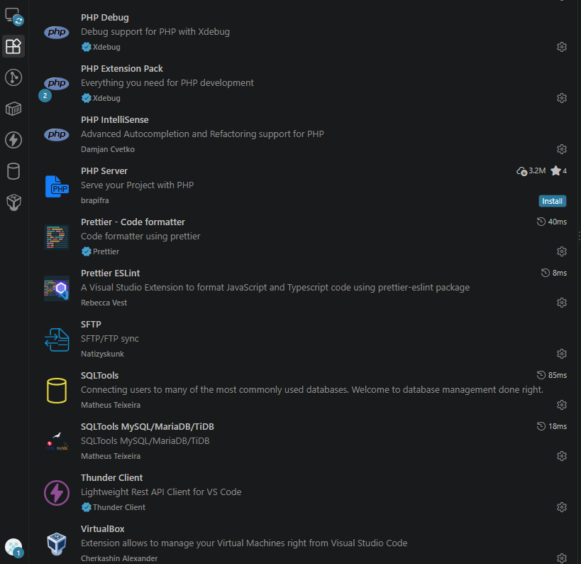

En la captura se distinguen el nombre de cada extensión y, debajo, su autor: **SFTP** de *Natizyskunk*, **SQLTools** y su driver de *Matheus Teixeira*, y **PHP Debug** de *Xdebug*. La insignia azul junto al autor indica un editor verificado.

> **Buena práctica.** Instala solo extensiones de editores conocidos y con muchas descargas, y fíjate en el nombre del autor: hay extensiones con nombres casi idénticos. Una extensión tiene acceso a tus archivos.

---

### 6.2. Configuración de Visual Studio Code: el workspace

Un *workspace* es una colección de una o más carpetas abiertas en una sola ventana del editor. Sirve para organizar proyectos y aplicar configuraciones específicas a cada uno. Se guarda como un archivo `.code-workspace` en formato JSON, fácil de editar y de compartir.

**Para crearlo:**

1. Abre una ventana vacía, sin ninguna carpeta abierta (`Ctrl + Shift + N`).
2. Arriba a la izquierda, ve a **File > Add Folder to Workspace…**

   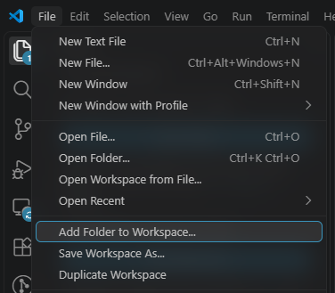

3. Se abre un explorador. Se recomienda crear una carpeta raíz para el workspace y, dentro, una carpeta por proyecto:

   ```text
   D:\
   └── PROYECTOS-VISUAL-STUDIO        -> carpeta del workspace general
       ├── JRODWESProyectoPEPE
       ├── JRODWECProyectoDWEC        -> carpetas de proyectos
       ├── JRODWESProyectoTema4
       ├── JRODWESProyectoTema5
       └── ...
   ```

   *Si vas a reutilizar proyectos o a crear otros nuevos, asegúrate de que estén dentro de `D:\PROYECTOS-VISUAL-STUDIO`.*

4. Selecciona las carpetas que están **dentro** de `PROYECTOS-VISUAL-STUDIO`, no la carpeta en sí (se pueden seleccionar todas a la vez).
5. En el explorador del editor aparecen los diferentes proyectos.

   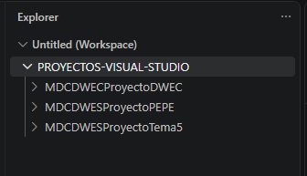

   Mientras el workspace no se guarde, aparece como **Untitled (Workspace)**.

6. **Importante:** ve a **File > Save Workspace As…** y guárdalo (preferiblemente en la carpeta del workspace) con el nombre `PROYECTOS-VISUAL-STUDIO.code-workspace`. Es necesario para algunas configuraciones posteriores.

   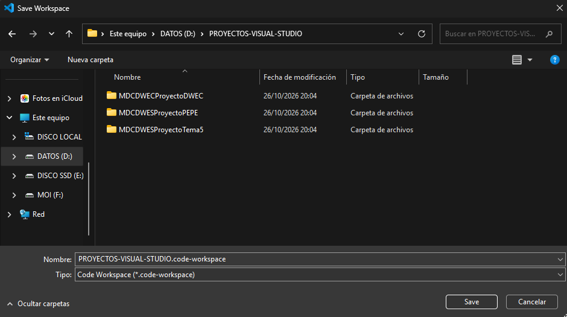

**Ajustes recomendados del workspace.** Abre el archivo `.code-workspace` y añade el bloque `settings` (las carpetas de `folders` ya estarán escritas):

```json
{
    "folders": [
        { "path": "JRODWESProyectoTema4" },
        { "path": "JRODWESProyectoTema5" }
    ],
    "settings": {
        "files.encoding": "utf8",
        "files.eol": "\n",
        "editor.tabSize": 4,
        "php.suggest.basic": false,
        "php.executablePath": "D:/php/php.exe",
        "php.validate.executablePath": "D:/php/php.exe"
    }
}
```

| Ajuste | Para qué |
|---|---|
| `files.encoding: utf8` | Misma codificación que el servidor: evita que tildes y eñes salgan mal |
| `files.eol: "\n"` | Finales de línea de Linux (LF). Windows usa CRLF, que da problemas en scripts ejecutados en el servidor |
| `editor.tabSize: 4` | Sangría de 4 espacios, el estándar de PHP (PSR-12) |
| `php.suggest.basic: false` | Desactiva las sugerencias básicas de PHP que trae VS Code, para que no se dupliquen con las de PHP IntelliSense |
| `php.executablePath` | Ruta del PHP de Windows que necesita PHP IntelliSense (se instala en el [apartado 6.4](#64-extensiones-de-php-intellisense-y-php-debug)) |
| `php.validate.executablePath` | El mismo PHP, usado por VS Code para subrayar los errores de sintaxis al guardar |

> **⚠️ Importante.** A partir de aquí, las configuraciones (SFTP, depuración, base de datos y Git) se aplican de forma independiente **dentro de cada uno de los proyectos** del workspace: cada proyecto tiene su propia carpeta `.vscode/`.

---

### 6.3. Extensión SFTP

Sincroniza la carpeta local del proyecto con la del servidor: cada vez que se guarda un archivo, lo sube por SFTP. Es el equivalente al *Upload Files: On Save* de NetBeans.

#### Instalación

Busca **SFTP** en la pestaña de extensiones e instálala. Hay varias con ese nombre; la que se usa aquí es la de **Natizyskunk** (descripción *"SFTP/FTP sync"*), como se ve en la captura del apartado 6.1.

#### Configuración

En cada proyecto se crea una carpeta `.vscode/` y, dentro, un archivo `sftp.json`. La forma rápida: con el proyecto seleccionado, `Ctrl + Shift + P` > **SFTP: Config**, que crea el archivo con una plantilla. *(También se puede copiar la carpeta `.vscode/` de un proyecto a otro y cambiar los valores.)*

Contenido del archivo (cambia `remotePath` en cada proyecto):

```json
{
    "name": "JRO-ConexionSFTP",
    "context": ".",
    "protocol": "sftp",
    "host": "10.199.8.97",
    "port": 22,
    "username": "operadorweb",
    "password": "paso",
    "remotePath": "/var/www/html/JRODWESProyectoTema4",
    "uploadOnSave": true,
    "ignore": [
        ".vscode",
        ".git",
        ".DS_Store"
    ],
    "remoteExplorer": {
        "filesExclude": [
            ".git",
            ".DS_Store",
            ".cache",
            ".local",
            ".bash_history",
            ".bashrc"
        ]
    }
}
```

| Clave | Qué hace |
|---|---|
| `name` | Nombre identificativo de la conexión |
| `context` | Carpeta local que se sincroniza (`.` = la carpeta del proyecto) |
| `protocol` / `port` | Protocolo y puerto de la conexión (SFTP, 22) |
| `host` | Dirección IP o dominio del servidor remoto |
| `username` | Usuario de acceso al servidor |
| `password` | Contraseña. Si no se pone, la pide cada vez que se cierra y se abre el editor |
| `remotePath` | Ruta del directorio de destino en el servidor |
| `uploadOnSave` | `true` = sube los archivos automáticamente al guardarlos |
| `ignore` | Archivos o carpetas que la extensión no debe subir |
| `remoteExplorer.filesExclude` | Archivos y carpetas que se ocultan en el explorador remoto |

> **Correcciones respecto a la versión anterior.**
> - El archivo tenía comentarios con `#` que había que borrar a mano: JSON **no admite comentarios**, y con ellos la extensión no carga la configuración. Ahora el archivo es válido tal cual y las explicaciones van en la tabla.
> - Se añade `.vscode` a `ignore`: sin ello, el propio `sftp.json`, con la contraseña dentro, se subía al servidor web.
> - La carpeta `remotePath` debe existir en el servidor (se creó en el [apartado 4.3](#43-ejemplo-de-uso-de-mobaxterm)).

#### Ejemplo de uso

1. Crea `index.php` en el proyecto, escribe `<?php echo "Hola desde VS Code";` y guarda (`Ctrl + S`).
2. En la barra de estado inferior aparece brevemente el aviso de subida de la extensión.
3. Abre `https://10.199.8.97/JRODWESProyectoTema4/` en el navegador: debe verse el mensaje.

**Sincronización manual.** Para imágenes o documentos copiados desde fuera del editor (que no pasan por "guardar"), selecciona el archivo, la carpeta o el proyecto entero en el explorador y, con clic derecho:

| Opción | Qué hace |
|---|---|
| **Upload File / Upload Folder** | Sube lo seleccionado al servidor |
| **Download File / Download Folder** | Lo descarga del servidor |
| **Sync Local -> Remote** | Deja el servidor igual que la carpeta local |
| **Sync Remote -> Local** | Deja la carpeta local igual que el servidor |
| **Sync Both Directions** | Sincroniza en ambos sentidos |

> **Cuidado con *Sync*.** A diferencia de *Upload*, las opciones *Sync* pueden sobrescribir archivos más recientes del otro lado. Ante la duda, usa *Upload* / *Download*.

El icono **SFTP** de la barra lateral abre el **explorador remoto**, que muestra los archivos del servidor sin salir del editor.

---

### 6.4. Extensiones de PHP: IntelliSense y PHP Debug

Son dos extensiones con funciones distintas, que se instalan juntas con el **PHP Extension Pack**: **PHP IntelliSense** ayuda a *escribir* el código (autocompletado, ayuda con los parámetros, ir a la definición) y **PHP Debug** permite *depurarlo* conectándose con Xdebug.

#### Instalación

**1. Instalar el paquete.** Busca **PHP Extension Pack** (de *Xdebug*) en la pestaña de extensiones e instálalo: añade a la vez **PHP Debug** y **PHP IntelliSense** (de Damjan Cvetko), como se ve en la captura del apartado 6.1.

**2. Instalar PHP en Windows.** PHP IntelliSense está escrita en PHP y necesita un intérprete de PHP en el propio equipo cliente (versión 7.4 o superior). No hace falta instalador ni permisos de administrador:

1. Descarga el archivo **Zip** de PHP para Windows (x64) desde <https://windows.php.net/download/>.
2. Descomprímelo en `D:\php`.
3. Comprueba que funciona desde `cmd` o PowerShell:

   ```powershell
   D:\php\php.exe -v
   ```

> **Aclaración importante.** Este PHP de Windows solo lo usa el editor para analizar el código. Las aplicaciones se siguen ejecutando en el servidor `JRO-USED`, con su PHP 8.5: conviene descargar la misma rama (8.5) para que las ayudas coincidan con lo que el servidor admite. Si `php.exe` da un error de `VCRUNTIME140.dll`, falta el *Visual C++ Redistributable*, enlazado en la misma página de descarga.

#### Configuración

**PHP IntelliSense** necesita saber dónde está `php.exe`. Se indica con los ajustes que ya se añadieron al workspace en el [apartado 6.2](#62-configuración-de-visual-studio-code-el-workspace):

```json
"php.suggest.basic": false,
"php.executablePath": "D:/php/php.exe",
"php.validate.executablePath": "D:/php/php.exe"
```

En las rutas de un archivo JSON se usa `/` (o `\\` doble), nunca una sola `\`. Si la extensión muestra el aviso *"PHP executable not found"*, la ruta de `php.executablePath` es incorrecta.

**PHP Debug** necesita un archivo `launch.json` en la carpeta `.vscode/` de cada proyecto. Se crea desde la pestaña **Run and Debug** (`Ctrl + Shift + D`) > *create a launch.json file* > **PHP**, y se deja así:

```json
{
    "version": "0.2.0",
    "configurations": [
        {
            "name": "Escuchar Xdebug (JRO-USED)",
            "type": "php",
            "request": "launch",
            "port": 9003,
            "pathMappings": {
                "/var/www/html/JRODWESProyectoTema4": "${workspaceFolder}"
            }
        }
    ]
}
```

| Clave | Qué hace |
|---|---|
| `port` | Puerto en el que escucha el editor; debe coincidir con `xdebug.client_port` del servidor (`9003`) |
| `pathMappings` | Correspondencia entre la ruta del proyecto en el servidor (izquierda) y la carpeta local (derecha). `${workspaceFolder}` es la carpeta del proyecto |

Igual que en NetBeans, la primera vez Windows pregunta si se permite a VS Code recibir conexiones: hay que **permitir el acceso** (puerto `9003`).

#### Ejemplo de uso

1. Crea en el proyecto el archivo `prueba_xdebug.php` y guárdalo (se sube solo al servidor):

   ```php
   <?php
   $numeros = [3, 7, 12];
   $suma = 0;

   foreach ($numeros as $numero) {
       $suma += $numero;      // Pon aquí el punto de ruptura
   }

   echo "La suma es: $suma";
   ```

2. Haz clic a la izquierda del número de la línea `$suma += $numero;`: aparece un círculo rojo (punto de ruptura). También con `F9`.
3. Pulsa `F5` para que el editor empiece a escuchar (la barra de estado cambia de color).
4. En el navegador abre `https://10.199.8.97/JRODWESProyectoTema4/prueba_xdebug.php`.
5. La página se queda "cargando" y VS Code se detiene en la línea marcada. En el panel **Variables** se ve cómo `$suma` vale 3, luego 10 y finalmente 22.

   | Tecla | Acción |
   |---|---|
   | `F10` | *Step Over*: ejecuta la línea y pasa a la siguiente |
   | `F11` | *Step Into*: entra en la función |
   | `Shift + F11` | *Step Out*: sale de la función actual |
   | `F5` | *Continue*: sigue hasta el siguiente punto de ruptura |
   | `Shift + F5` | Detiene la depuración |

6. Al continuar, el navegador muestra `La suma es: 22`.

**Ejemplo de uso de PHP IntelliSense:** escribe `str_` y aparece la lista de funciones de PHP; al abrir el paréntesis de una función se muestran sus parámetros; `F12` (o `Ctrl + clic`) sobre una función propia salta a su definición; al pasar el ratón sobre una función se ve su documentación PHPDoc. Los errores de sintaxis se subrayan en rojo al guardar.

**PHPDoc en VS Code:** los comentarios se escriben igual que en NetBeans (ver el [apartado 5.3.5](#535-documentar-el-código-con-phpdoc)) y PHP IntelliSense los muestra al pasar el ratón. Para que el editor genere la plantilla al escribir `/**`, se puede añadir la extensión opcional **PHP DocBlocker**.

> 📷 *Captura recomendada:* VS Code detenido en el punto de ruptura, con el panel **Variables** visible.

---

### 6.5. Extensión SQLTools

Convierte VS Code en un cliente de bases de datos: permite conectarse a MariaDB, explorar tablas y ejecutar consultas sin salir del editor.

#### Instalación

Instala **SQLTools** y su driver **SQLTools MySQL/MariaDB/TiDB** (ambas de Matheus Teixeira). SQLTools por sí sola no sabe hablar con ningún gestor: necesita un driver por cada tipo de base de datos.

#### Configuración

1. En la barra lateral izquierda, haz clic en el icono de base de datos de SQLTools (un pequeño cilindro).
2. Haz clic en **Add New Connection** y selecciona el driver **MariaDB** (o **MySQL**).

   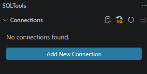

3. Rellena los datos del servidor en el asistente (*Connection Assistant*):

   | Campo | Valor |
   |---|---|
   | Connection name | `JRO-BaseDatos` |
   | Connect using | `Server and Port` |
   | Server Address | `10.199.8.97` |
   | Port | `3306` |
   | Database | `mysql` |
   | Username | `adminsql` |
   | Password mode | `Ask on connect` (la pide al conectar; contraseña: `paso`) |
   | SSL / Over SSH | `Disabled` (valores por defecto) |

   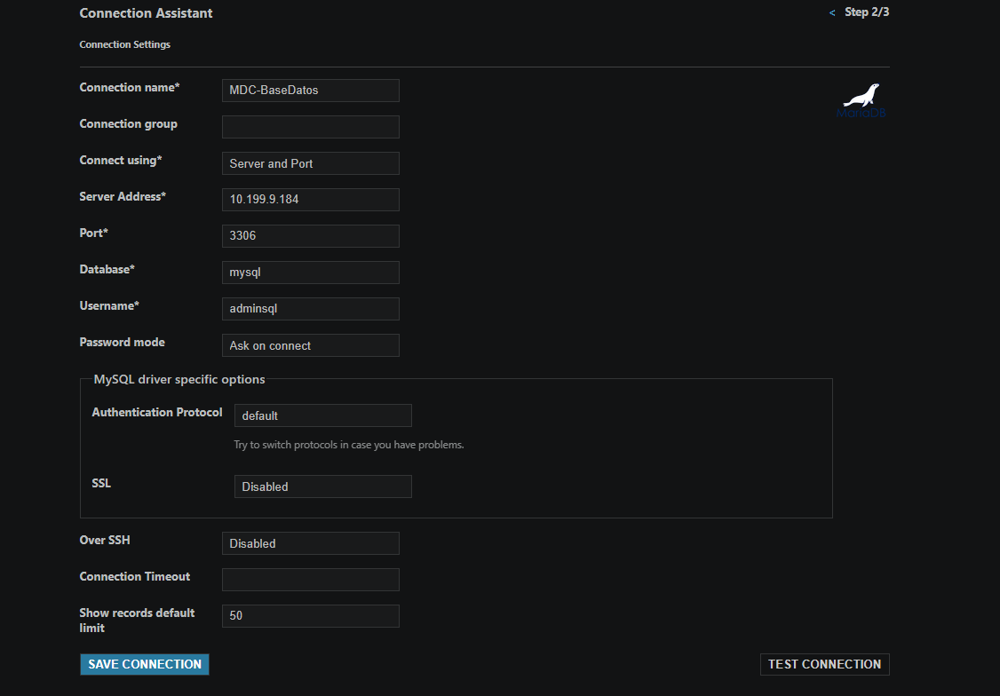

   > **Modos de contraseña.** *Ask on connect* la pide en cada conexión y no la guarda en ningún archivo: es la opción más segura. *Save as plaintext in settings* la escribe en claro en la configuración de VS Code y debe evitarse en un equipo compartido.

4. Haz clic en **Test Connection** para comprobarla, después en **Save Connection** y, por último, en **Connect Now**.

> **Dato útil.** `mysql` es la base de datos interna donde MariaDB guarda sus usuarios y permisos, y existe siempre: por eso sirve como base de datos inicial. Como `adminsql` tiene todos los privilegios, desde esa conexión se ven también las demás.

#### Ejemplo de uso

1. Al conectar se abre un archivo `.session.sql`. Escribe:

   ```sql
   SHOW DATABASES;
   SELECT User, Host FROM mysql.user;
   ```

2. Ejecuta con **Run on active connection** (encima de la consulta) o con `Ctrl + E` seguido de `Ctrl + E`. Los resultados aparecen en una pestaña lateral, en forma de tabla, y se pueden exportar a CSV o JSON.
3. En el panel de SQLTools, despliega la conexión para explorar bases de datos, tablas y columnas; la lupa junto a una tabla muestra sus registros.

---

### 6.6. Control de versiones con Git

VS Code trae integrado el panel de control de versiones, pero **no trae Git**: usa el que haya instalado en Windows.

#### Instalación

1. Descarga **Git for Windows** desde <https://git-scm.com/download/win> e instálalo con las opciones por defecto.
2. Reinicia VS Code.
3. Comprueba la instalación en la terminal integrada (`` Ctrl + ` ``):

   ```bash
   git --version
   ```

#### Configuración

**Identidad.** Git firma cada commit con un nombre y un correo. Se configura una sola vez:

```bash
git config --global user.name "Juan Rivera Ordóñez"
git config --global user.email "juan.rivord@educa.jcyl.es"
git config --global init.defaultBranch main
```

**Autenticación.** La primera vez que se hace *push*, se abre una ventana para iniciar sesión en GitHub desde el navegador; Git for Windows guarda la credencial y no vuelve a pedirla.

**Archivo `.gitignore`.** En la raíz de cada proyecto, para no subir archivos residuales del sistema ni la configuración del editor:

```text
.bash_history
.bashrc
.wget-hsts
.cache/
.dotnet/
.local/
.ssh/
.vscode-server/
.vscode/

*.code-workspace
nbproject/
```

> **Por qué es importante.** La línea `.vscode/` evita subir a GitHub el archivo `sftp.json`, que contiene la contraseña del servidor. Si un archivo ya se subió antes de añadirlo al `.gitignore`, sigue en el historial: hay que quitarlo con `git rm --cached archivo` y cambiar la contraseña.

**Escenario A: inicializar un proyecto nuevo.** Si el proyecto todavía no tiene Git:

1. Abre el panel de control de versiones (`Ctrl + Shift + G`, o el icono de ramas de la barra lateral) y haz clic en **Initialize Repository**.
2. Aparecen todos los archivos bajo la sección *Changes* (cambios).
3. Para indicar qué archivos entran en la versión, pulsa el icono **`+`** (*Stage Changes*) junto a cada archivo, o junto a la palabra *Changes* para añadirlos todos.
4. Escribe un mensaje descriptivo en el cuadro de texto y pulsa **Commit** (o el *check* `✓`).
5. Para conectarlo con GitHub: menú `...` del panel > **Remote > Add Remote…**, pega la URL del repositorio vacío y, después, pulsa **Publish Branch**.

**Escenario B: clonar un proyecto de GitHub.** Para traer un proyecto existente:

1. Pulsa `Ctrl + Shift + P` para abrir la paleta de comandos.
2. Escribe `Git: Clone` y pulsa Enter.
3. Pega la URL del repositorio de GitHub y pulsa Enter.
4. Selecciona la carpeta de destino (`D:\PROYECTOS-VISUAL-STUDIO`).
5. VS Code pregunta si quieres abrir el repositorio clonado: elige **Add to Workspace** para añadirlo al workspace actual.

#### Ejemplo de uso

| Acción | Cómo se hace |
|---|---|
| **Stage y Commit** | Los archivos modificados aparecen en el panel. Pulsa **`+`** para pasarlos al área de preparación (*Staged Changes*), escribe qué has hecho y pulsa **Commit** |
| **Sync Changes** | Tras el commit, el botón azul cambia a **Sync Changes**: hace un *Pull* y un *Push* seguidos (descarga los cambios de otros y sube los tuyos) |
| **Pull / Push / Fetch** | Menú de los tres puntos `...`, en la parte superior derecha del panel |
| **Ramas** | En la esquina inferior izquierda de la ventana se ve la rama actual (`main` o `master`). Al hacer clic se pueden crear ramas nuevas o cambiar a otra |
| **Ver qué ha cambiado** | Clic sobre un archivo del panel: se abre la comparación (*diff*) entre la versión anterior y la actual |
| **Tags y stashes** | Menú `...` > **Tags** / **Stash** |

**Letras junto a los archivos:** `U` = nuevo sin registrar (*untracked*), `M` = modificado, `A` = añadido al área de preparación, `D` = borrado, `C` = en conflicto.

*(El esquema de las cuatro zonas de Git está en el [apartado 5.2.3](#523-conexión-con-el-repositorio-git).)*

---

### 6.7. Extensiones opcionales

No son necesarias para el flujo de trabajo, pero resultan útiles:

| Extensión | Para qué sirve | A tener en cuenta |
|---|---|---|
| **Live Server** | Abre una página HTML en el navegador y la recarga sola al guardar | Solo sirve para HTML, CSS y JavaScript: **no ejecuta PHP**. Para PHP se usa siempre el servidor `JRO-USED` |
| **Prettier** | Da formato automático al código (HTML, CSS, JavaScript, JSON) | No formatea PHP por defecto; se aplica con `Shift + Alt + F` |
| **HTML CSS Support / IntelliSense** | Autocompleta en el HTML las clases definidas en los archivos CSS | — |
| **VirtualBox** | Arranca y apaga las máquinas virtuales desde VS Code | Útil cuando el servidor es una máquina virtual del propio equipo |
| **Thunder Client** | Envía peticiones HTTP (GET, POST…) desde el editor, para probar formularios y servicios web (API REST) | Alternativa ligera a Postman |

---

## 7. Resumen y solución de problemas

**Comparativa de las dos herramientas de desarrollo:**

| Tarea | NetBeans | Visual Studio Code |
|---|---|---|
| Subir archivos al guardar | *Run Configuration > Upload Files: On Save* | Extensión SFTP (`uploadOnSave`) |
| Probar en el navegador | **Run** (`F6`) | Abrir la URL a mano |
| Base de datos | Pestaña *Services > Databases* | Extensión SQLTools |
| Git | Integrado (menú *Team > Git*) | Panel *Source Control* + Git for Windows |
| Depurar | **Debug Project** (`Ctrl + F5`) | `F5` con `launch.json` |
| Paso a paso | `F8` / `F7` | `F10` / `F11` |
| Dónde se guarda la configuración | Carpeta `nbproject/` | Carpeta `.vscode/` |

**Problemas habituales:**

| Síntoma | Causa probable | Solución |
|---|---|---|
| No conecta por SSH ni por SFTP | El servidor está apagado, o la IP es la de la otra red (clase/casa) | `ping 10.199.8.97`; revisar la red del servidor |
| El archivo se guarda pero la web no cambia | No se ha subido, o se ve una copia en caché | Revisar *Upload Directory* / `remotePath`; recargar con `Ctrl + F5` |
| *Permission denied* al subir | La carpeta del servidor no es de `operadorweb` | En el servidor: `sudo chown -R operadorweb:www-data /var/www/html` |
| La extensión SFTP no hace nada | `sftp.json` no es un JSON válido (comentarios, comas sobrantes) | Revisar el archivo; VS Code subraya los errores |
| La página sale en blanco o con error 500 | Error de PHP | En el servidor: `sudo tail /var/log/apache2/daw-ssl-error.log` |
| *Test Connection* de la base de datos falla | MariaDB no escucha en la red o el puerto está cerrado | En el servidor: `sudo ss -tlpn \| grep 3306` y `sudo ufw status` |
| El depurador no se detiene | El IDE no está escuchando, el cortafuegos de Windows bloquea el 9003 o falta el *path mapping* | Iniciar la depuración **antes** de cargar la página; revisar el cortafuegos y las rutas; en el servidor: `sudo tail /var/log/xdebug.log` |
| Tildes y eñes se ven mal | El archivo no está en UTF-8 | Guardar como UTF-8 (barra de estado de VS Code; *Properties* del proyecto en NetBeans) |
| GitHub rechaza la contraseña | GitHub ya no admite contraseñas para Git | Usar un token de acceso personal |

---

## Créditos

**Autor:** Juan Rivera Ordóñez

**Documentación elaborada en equipo con:**

- Juan Miguel Domínguez Perdigón
- Moisés Alberto Domínguez Cruz

Las capturas de pantalla fueron tomadas por los compañeros del equipo en sus propios equipos; por eso algunas muestran otros nombres de proyecto y otras direcciones IP.
